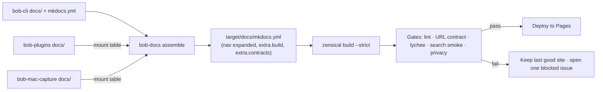

- **PROMPT:** [prompts/202610/bob_public_docs_site.md](https://github.com/bobs-org/bob-cli--agents/blob/main/prompts/202610/bob_public_docs_site.md)
- **BEAD:** [bob-cli-a0](https://github.com/bobs-org/bob-cli--beads/blob/main/pages/bob-cli-a0/README.md)

# Plan: Bob public docs site on GitHub Pages

## Why

Bob already has about 30,000 lines of documentation. Nobody can find it: there is no
cross-repo search, no navigation, and no build that fails on a broken link. The
canonical research report recommends one Diátaxis-organized site at the GitHub org root,
built with Zensical, with the existing contracts published unchanged. This epic
implements that report end to end. **Every phase reads it first:**

```bash
sase artifact read research:202610/bob_public_docs_site/bob_public_docs_site.md "Implementing the Bob public docs site epic"
```

The report sets the scope. This plan settles the open design questions, the exact
contracts between phases, and what each phase delivers. Where they differ, this plan
wins.

**Design goals, in order:** _intuitive_ (four reader doors, goal-titled guides, products
shown as reference sections rather than manuals), _reliable_ (generated facts, strict
gates, frozen URLs, a last-good site that is never replaced by a broken one), and
_beautiful_ (Bob's own identity, a reading-first layout, real examples).

## Verified toolchain facts (scratch probe, 2026-10-19)

- `zensical==0.0.71` (Python ≥ 3.11) builds the proposed `mkdocs.yml`. With `--strict`
  it **exits 1** on a broken anchor and prints the file and column. The `0.1.0`
  dependable line starts 2026-11-05.
- Zensical's MiniJinja overrides can read custom front matter (`page.meta.source`) and
  `page.edit_url`.
- The `github-callouts` extension (from the `markdown-callouts` package) renders GitHub
  `> [!NOTE]` alerts as admonitions. Plain Zensical shows `[!NOTE]` as literal text.
- **A custom superfences formatter in an installed Python package**
  (`format: !!python/name:<pkg>.<fn>`) works in Zensical and in Material. This is how
  the `bob-task` fence works.
- `redirects` (it writes static stubs) and `llmstxt` (it writes per-page `index.md`
  copies) are native. `variant: classic` is accepted by Zensical and ignored by
  Material.
- The search index is `search.json`:
  `{config: {separator}, items: [{location, title, text, path, tags}]}`. Its separator
  splits on `! = [ ] ( ) : - _ ,`, so syntax tokens need their own named headings to be
  findable.
- **Zensical does not report pages missing from `nav`. Material 9.7 does, and strict
  mode fails on them.** Our lint must check nav completeness so both builders agree.
- `mkdocs-material==9.7.7` with `mkdocs-redirects`, `mkdocs-llmstxt`, and
  `markdown-callouts` builds the same config unchanged. It is the fallback builder.
- Playwright's cached Chromium is available on this host for visual and accessibility
  checks. `gh` is logged in as an admin of `bobs-org`, which is on GitHub Free with
  public Pages allowed. `bobs-org/bobs-org.github.io` does not exist yet.

## Design

### Shape, URL, and ownership

- **One site for the Bob system** at `https://bobs-org.github.io/`. Repos appear as
  reference sections and component tags, never as top-level manuals.
- **Source lives with the code.**
  - **bob-cli** owns the site shell (`mkdocs.yml`, `tools/docs/`, theme, homepage), all
    system-wide pages, the generated reference, and the 26 contracts.
  - **bob-plugins** owns plugin reference in its own `docs/`.
  - **bob-mac-capture** owns Mac reference in its own `docs/`.
  - **`bobs-org/bobs-org.github.io`** only publishes. It holds two caller workflows,
    `published.json`, and a README.
- **URL = path.** `docs/X.md` publishes at `/X/`, and `docs/guides/y.md` at
  `/guides/y/`. Every `docs/X.md` mention in help text, errors, tests, plans, and memory
  therefore maps to a live page. Contracts are never moved; splitting one adds pages and
  never removes the old URL.

### Source layout

```text
bob-cli/
├── mkdocs.yml                      # Zensical-built; Material-9.7-compatible subset only
├── tools/docs/                     # uv project "bob-docs" (package bob_docs, CLI bob-docs)
│   ├── pyproject.toml  uv.lock
│   ├── bob_docs/                   # assemble, lint, urls, search_smoke, fences, gen_*, fonts,
│   │                               #   a11y, tutorial, media, publish_plan, host
│   ├── host/                       # caller workflows + README synced into the deploy repo
│   └── tests/                      # pytest
├── .github/workflows/
│   ├── docs-publish.yml            # on: workflow_call ONLY (never runs in bob-cli itself)
│   └── docs-weekly.yml             # on: workflow_call ONLY
├── examples/demo-vault/            # synthetic documentation fixture (learn phase)
├── tests/cli/docs_reference.rs     # golden CLI reference (generated phase)
└── docs/
    ├── index.md                    # homepage
    ├── start/ guides/ concepts/ reference/ develop/       # typed reader pages
    ├── capture.md freshness.md …   # the 26 contracts, unchanged → /capture/ …
    ├── README.md                   # GitHub/agent hub; excluded from the site
    ├── _meta/                      # contracts.yml, mounts.yml, budgets.yml, url_contract.txt,
    │                               #   url_mentions_ignore.txt, search_smoke.yml, media.yml,
    │                               #   privacy.yml, privacy_baseline.txt   (excluded)
    ├── _templates/                 # tutorial, how-to, concept, reference, hub (excluded)
    ├── overrides/  stylesheets/  assets/{fonts,media}/  robots.txt
    ├── reference/plugins/          # ← mounted copy of bob-plugins/docs (gitignored)
    └── reference/mac-capture/      # ← mounted copy of bob-mac-capture/docs (gitignored)
```

Build outputs never touch tracked files. They go under `target/docs/`: the assembled
config `target/docs/mkdocs.yml` (its paths point back at `docs/`), the site
`target/docs/site/`, `build.json`, and the a11y screenshots.

### Build pipeline



### Rules every phase follows

1. **Directory = type.** The typed directories are `start/` (tutorials), `guides/`
   (how-to), `concepts/` (explanation), `reference/` (lookup, generated where possible),
   and `develop/` (contributor material and process). At the root, only `index.md` and
   the contracts registered in `docs/_meta/contracts.yml` may exist. No contract stem
   may equal a typed directory or a mount root.
2. **Placement test** (Diátaxis's two questions): action or cognition, study or work.
   Contracts are a fifth bucket: "a spec that tests or two runtimes must agree on". The
   information architecture is Bryan's decision. Agents never move pages between tabs
   without an approved plan.
3. **Config stays in the Zensical ∩ Material 9.7 subset.**
   - No `hooks:`, and no `gen-files`.
   - The plugin allowlist is `search`, `redirects`, `tags`, `llmstxt`; the lint enforces
     it, because Zensical silently ignores unknown plugins.
   - `theme.variant: classic` and `theme.font: false`.
   - All generation runs in `tools/docs/` (or the Rust golden test) **before** the
     build, and its output is committed with a `--check` drift mode.
4. **Generated content** sits between `<!-- BEGIN GENERATED: name -->` and
   `<!-- END GENERATED: name -->` (in YAML: `# BEGIN GENERATED: name` /
   `# END GENERATED: name`). A whole generated page carries
   `<!-- generated by <tool>; run just docs-gen -->` on its first body line. Generated
   pages are exempt from word budgets.
5. **Front matter.** Typed pages require `title` and a `description` of at most 160
   characters. The allowed keys are
   `title, description, hide, search, tags, template, icon, status`, plus `source`,
   which only the assembler stamps on mounted copies. Contracts need no front matter.
6. **Word budgets.** Words are counted outside front matter, code, HTML comments, and
   generated blocks.
   - `start/` pages: ≤ 2,500 each, ≤ 10,000 for the tier.
   - `guides/`: target 1,500 (warning), hard limit 2,500.
   - `concepts/`: ≤ 3,000.
   - Hubs (`*/index.md`) and the homepage: ≤ 400.
   - Hand-written `reference/` pages, including mounted ones: ≤ 6,000.
   - `develop/`: ≤ 8,000 (warning only).
   - Contracts are exempt. `docs/_meta/budgets.yml` holds per-page ceilings that ratchet
     down only.
7. **Hygiene.**
   - In `start/`, `guides/`, and `concepts/`, these are forbidden: bead IDs
     (`bob-cli-…`, `bob-plugins-…`, `bob-mac-capture-…` shapes), `src/` paths, epic or
     phase labels, and history words (`formerly`, `no longer`, `legacy`, `renamed`).
   - `reference/` forbids bead IDs.
   - The scanner skips code and link destinations.
   - Rust and JS tests never read `docs/{start,guides,concepts}/`. Only the tutorial
     runner and the lint's own tests may.
8. **Portable Markdown.** Agents and GitHub read the same files as the site.
   - Use GitHub `> [!NOTE]` callouts, standard tables, raw `<kbd>Ctrl</kbd>`, and fenced
     code.
   - Never use `!!!` admonitions, `===` content tabs, or `++ctrl++` keys; the lint bans
     them.
   - Commands go in `bash` fences **without `$` prompts**, so copy buttons never copy
     prompts. Output goes in a separate `text` fence titled `Output` and marked
     `.no-copy`.
9. **Cross-repo links.** Same-repo links are relative. Links from mounted docs to
   bob-cli pages, and every link in a README, use absolute
   `https://bobs-org.github.io/…` URLs. `bob-docs urls` validates them against the local
   build.
10. **Privacy.**
    - Examples and images come only from the synthetic demo vault, the Mac CI render
      fixtures, or generators.
    - Every image file must be listed in `docs/_meta/media.yml` (or the mounted repo's
      `docs/media.yml`) with its source and date.
    - Patterns in `docs/_meta/privacy.yml` (real home paths, the private vault repo,
      personal LaunchAgent labels, email addresses) fail on reader pages and mounts.
    - Contracts are ratcheted by `privacy_baseline.txt`: existing hits are allowed, and
      new ones fail.
11. **Verification.**
    - Every bob-cli docs change passes `just docs-check`.
    - Rust changes also pass `just check`.
    - bob-plugins changes pass `npm test && npm run validate`.
    - bob-mac-capture gets docs, scripts, and recipes only. **No Swift changes in this
      epic.**
    - Commands quoted in pages are verified against current master in a temporary
      `HOME`.
12. **Leftovers.** When a phase cannot finish an item, it records a
    `PROPOSED FOLLOW-UP:` note on its phase bead, saying what is missing and why. The
    `polish` phase collects these notes into the handoff research artifact.

### `bob-docs` and just recipes

`tools/docs` is a uv project. Every recipe wraps
`uv run --project tools/docs bob-docs …` and prints the repo's usual themed `_banner`.
`bob-docs --help` follows the CLI help rules: sorted options, clear one-line
descriptions.

| Recipe                                                      | Runs                                                          | Purpose                                                                                                                       |
| ----------------------------------------------------------- | ------------------------------------------------------------- | ----------------------------------------------------------------------------------------------------------------------------- |
| `just docs-serve`                                           | `bob-docs serve`                                              | Assemble, then `zensical serve` (live reload for bob-cli pages)                                                               |
| `just docs-build`                                           | `bob-docs build`                                              | Assemble and run a strict Zensical build to `target/docs/site`                                                                |
| `just docs-build-material`                                  | `bob-docs build --material`                                   | The same files built with Material 9.7 (fallback proof)                                                                       |
| `just docs-gen`                                             | Rust golden test with `BOB_UPDATE_GOLDENS=1` + `bob-docs gen` | Regenerate every generated page and block                                                                                     |
| `just docs-check`                                           | `bob-docs check`                                              | lint, `gen --check`, CLI golden test, build, URLs, lychee, search smoke, pytest (+ tutorial and media checks once they exist) |
| `just docs-a11y`                                            | `bob-docs a11y`                                               | Playwright screenshots (360/768/1280 × light/dark) + axe-core; dev-only                                                       |
| `just docs-fonts`                                           | `bob-docs fonts`                                              | Re-subset the bundled OFL fonts to woff2                                                                                      |
| `just docs-tutorial` / `docs-media`                         | learn phase                                                   | Run the tutorial on the demo vault / regenerate CLI SVG captures                                                              |
| `just docs-publish` / `docs-status` / `docs-host-bootstrap` | publish phase                                                 | Dispatch a publish now / show live state / create or resync the deploy repo                                                   |

Each gate joins `docs-check` in the phase that creates it. `docs-check` is never green
by silently skipping: an absent optional gate (no `cargo`, offline) prints an explicit
`skipped: <reason>` line.

### Assembler and the mount table

`docs/_meta/mounts.yml` lists each mount: `repo`, `remote`, `branch`, `source` (a
directory inside that repo), `target` (a path under `docs/`), and `nav_title`. A repo
may have several mounts, for example `docs/` → `reference/plugins/` and `docs/develop/`
→ `develop/plugins/`. The table **starts empty**; the plugins-ref and mac-ref phases add
their entries.

- **Sibling discovery order:** `BOB_DOCS_<REPO>_DIR` env var → `../<repo>` (the
  `install-all` layout) → `sase/repos/linked/<repo>` (agent workspaces) → a shallow
  clone into `~/.cache/bob-docs/<repo>`. **A sibling is never skipped silently.** A
  missing one fails with the discovery trail.
- **Copying.** Copy `source/**` into `docs/<target>/`, a gitignored path (the lint
  checks that it is gitignored). Fail on any path collision, any path escape, or a
  symlink pointing outside the repo. Never rewrite links.
- **Provenance.** Stamp `source: <repo>:<path>` into each copied page's front matter.
  The `main.html` override builds "Edit this page" from it. Also write
  `target/docs/build.json` (repo → SHA, dirty flag, branch, plus build time and tool
  versions) and inject it into the assembled config as `extra.build`.
- **Nav expansion.** Each mount ships a `nav.yml` next to its `index.md` that lists its
  pages in order. The assembler replaces the committed nav placeholder
  (`- Obsidian plugins: reference/plugins/index.md`) with the expanded section. Every
  page must appear exactly once, so nav changes in a sibling never require a bob-cli
  commit.
- **Contracts.** Inject `docs/_meta/contracts.yml` as `extra.contracts`; the banner
  template reads it.
- **YAML round-trip.** The assembled config is a YAML round-trip of `mkdocs.yml` that
  preserves `!!python/name:` tags. Unit-test this.
- **Production mode** (`--production --sources <json>`) accepts only explicit
  directories. It verifies each `HEAD` equals the recorded SHA and that the tree is
  clean, and it refuses env or local overrides.

### URL contract

1. **Pages ever published.** Each build writes `/urls.txt`, a sorted list of page URLs.
   The gate fetches the live `https://bobs-org.github.io/urls.txt`. Every page URL live
   today must resolve in the new build, as a page or as a `redirects` stub. A removed
   page therefore needs a redirect. Offline, or before the first publish, this step
   warns.
2. **Scanned mentions.**
   - Every `docs/<path>.md(#fragment)` mention in bob-cli `src/`, `tests/`, `README.md`,
     and `docs/` must resolve to a built page and anchor. False positives such as
     fixture paths go in `url_mentions_ignore.txt` with a reason.
   - Every `https://bobs-org.github.io/…` URL in the three READMEs and in all docs,
     mounts included, must resolve.
3. **Curated inbound links.** `docs/_meta/url_contract.txt` lists absolute URLs with
   fragments that outside places rely on.

Heading anchors in contracts are deliberately **not** frozen wholesale: contracts change
daily, and that would block publishing constantly.

### Visual identity: "a calm working notebook"

Warm paper, dark ink, Bob's teal for interaction, and tomato **reserved for Today and
Pomodoro** so 🍅 keeps its meaning. Typography and real examples carry the design.

| Token                              | Light                                                      | Dark                           |
| ---------------------------------- | ---------------------------------------------------------- | ------------------------------ |
| Surface / body text                | `#FBF8F2` / `#171C1A` (16.3:1)                             | `#121816` / `#EEF3ED` (16.0:1) |
| Muted text                         | `#5C5F5A` (6.1:1)                                          | `#A3A9A2` (7.5:1)              |
| Links, active tab                  | `#0F6B63` (6.0:1)                                          | `#79DEDC` (11.4:1)             |
| Teal glyphs and chips              | `#0A9391` glyphs only; surfaces at a 10–14% mix            | `#79DEDC` at a 12% mix         |
| Tomato text                        | `#9B3D2D` (6.4:1)                                          | `#F58B72` (7.6:1)              |
| Tomato glyph (Today/Pomodoro only) | `#D9472B` (icons and large text only)                      | `#F58B72`                      |
| Caution callout                    | a non-tomato crimson that passes AA (choose and record it) | its dark pair                  |

- **Type.**
  - Inter for UI and body, Inter Display SemiBold for headings, JetBrains Mono for code,
    and optionally Source Serif 4 SemiBold for the hero headline only.
  - All are self-hosted, subsetted woff2 files from `assets/print_fonts/` (OFL; ship
    `OFL.txt` beside them), with no Google Fonts requests.
  - At most two families on article pages.
- **Article pages.**
  - 65–75 character measure, 17–18 px body, line height about 1.65, underlined prose
    links.
  - Visible teal focus rings and a skip link.
  - The "On this page" rail and left nav collapse on mobile.
- **The mark.** Port `StatusItemGlyph.swift` exactly. The 18×18 canvas is y-down, like
  SVG:

  ```svg
  <svg xmlns="http://www.w3.org/2000/svg" viewBox="0 0 18 18" width="18" height="18">
    <g fill="none" stroke="currentColor" stroke-width="1.5">
      <line x1="4.25" y1="3.25" x2="4.25" y2="10" stroke-linecap="round"/>
      <circle cx="9" cy="10" r="4.75"/>
    </g>
    <circle cx="9" cy="10" r="1.6" fill="currentColor"/>
  </svg>
  ```

  Use it for the header logo, favicon (plus a 32 px PNG drawn with Pillow), and social
  card, so the docs, the menu bar, and the app share one mark.

- **Signature details.**
  - **`bob-task` fences render task lines the way Bob renders them** (details in the
    theme phase).
  - **Keycaps** look like small physical keys.
  - **Component chips** carry text, never color alone.
  - At most one Mermaid diagram per concept page, themed from the tokens.
  - No autoplay, and transitions honor `prefers-reduced-motion`.
  - Core content is readable without JavaScript.

### Target information architecture

Tabs are **Get started · Guides · Concepts · Reference · Develop**. The homepage doors
are **Learn / Do / Understand / Look up**, matching sase.sh. A tab or door appears only
once it has a real non-hub page; the lint enforces this for tabs, and each phase adds
its door.

- **Get started:** Is Bob for me? · Install Bob · Your first Bob day · Continue in
  Obsidian · Continue with Mac Capture.
- **Guides**, by group:
  - Set up
  - Capture
  - Plan the day
  - Projects and dependencies
  - Reading
  - Fix problems
- **Concepts:** How Bob fits together · Tasks and lanes · Today and the Pomodoro ledger
  · Freshness and the review walk · Projects and dependencies · The reference library ·
  Why the vault syncs through git.
- **Reference:** CLI (generated, grouped by `bob --help` sections) · Capture syntax ·
  Vault format · Configuration and environment · JSON outputs · Obsidian plugins (mount)
  · Mac Capture (mount) · Glossary (generated) · By component (generated) ·
  Compatibility.
- **Develop:**
  - Contracts (26, grouped, generated nav)
  - Design decisions (generated)
  - Writing docs
  - Reader testing
  - Build each repo (including the mounted plugin and Mac develop pages)
  - Release checklist
  - Migration notes

### Reliability gates

| Gate                                                          | Local `docs-check`       | Publish                                           | Catches                                                        |
| ------------------------------------------------------------- | ------------------------ | ------------------------------------------------- | -------------------------------------------------------------- |
| `zensical build --strict`                                     | ✓                        | ✓                                                 | broken internal links and anchors, malformed pages             |
| Nav completeness and tab population (lint)                    | ✓                        | ✓                                                 | orphan pages that Zensical ignores; empty tabs                 |
| Plugin allowlist, no `hooks:` (lint)                          | ✓                        | ✓                                                 | config that Zensical silently ignores                          |
| Front matter, budgets, hygiene, portability, privacy (lint)   | ✓                        | ✓                                                 | IA erosion, leaks                                              |
| `gen --check` (Python)                                        | ✓                        | ✓                                                 | drift in contracts hub, glossary, decisions, By component, nav |
| CLI golden test                                               | ✓ (also in `just check`) | — (needs Rust; committed output is gated locally) | help vs reference drift                                        |
| URL contract (all three layers)                               | ✓                        | ✓                                                 | broken inbound links                                           |
| lychee offline with fragments over `target/docs/site`         | ✓                        | ✓                                                 | an independent second link check                               |
| Search smoke (`_meta/search_smoke.yml` against `search.json`) | ✓                        | ✓                                                 | unfindable syntax tokens and goals                             |
| Tutorial runner and media determinism                         | ✓ when `cargo` exists    | —                                                 | a copied command that fails or drifts                          |
| Material fallback build, external links online                | —                        | weekly                                            | a dead fallback; external rot                                  |

lychee is resolved from `$LYCHEE`, then `PATH`, then a pinned release downloaded with
SHA-256 verification into `~/.cache/bob-docs/bin/` (Linux x86_64 and aarch64, macOS
arm64). It is never assumed to be installed.

### Publishing

The flow is an hourly poll with no cross-repo secrets.

- **Caller workflows.** The deploy repo's `publish.yml` runs on cron `17 * * * *` and on
  `workflow_dispatch` with inputs `force`, `drill`, and `pinned`. It grants
  `contents: write, pages: write, id-token: write, issues: write` and calls
  `bobs-org/bob-cli/.github/workflows/docs-publish.yml@master`. All publish logic is
  therefore versioned in bob-cli, and the deploy repo stays a 30-line shim.
- **Run steps:**
  1. `bob-docs publish-plan` runs `git ls-remote` on bob-cli and every mount repo
     (mounts read from `mounts.yml` at the bob-cli HEAD).
  2. If every SHA equals `published.json`, it exits.
  3. Otherwise it shallow-clones and computes the docs-input fingerprint. The inputs are
     bob-cli's `HEAD:docs`, `HEAD:mkdocs.yml`, `HEAD:tools/docs`, and the
     `.github/workflows/docs-*.yml` trees, plus each mount's source tree. If the
     fingerprint is unchanged, it exits without committing.
  4. Build and run the gates with `bob-docs check --production`.
  5. Upload the Pages artifact, then deploy with `actions/deploy-pages`. Use concurrency
     group `pages` without cancel-in-progress. Deploy only from the deploy repo's
     default branch, and never on a drill. `force` rebuilds even when the fingerprint is
     unchanged.
  6. Commit `published.json`: schema, sources (SHA and tree), fingerprint, toolchain
     versions, run URL, and time.
  7. `curl` every URL in the new `/urls.txt`, plus the curated contract, against the
     live site, with retries.
  8. Close the "Docs publish blocked" issue.
- **On any failure,** open or update that single issue (label `docs-publish`) with the
  failing step and the run link. The live site stays as it was.
- **Rollback.** Set `"hold": true` and the desired SHAs in `published.json`, then
  dispatch with `pinned=true`. Scheduled runs skip while `hold` is set.
- **Drill.** `drill=true` injects a broken link before the gates. The run must fail
  before deploying and open the issue; the next normal run closes it.
- **Weekly.** `docs-weekly.yml` runs the Material fallback build and an online external
  link check, and keeps its own single issue.
- **60-day inactivity.** Scheduled workflows in a public repo are disabled after 60 days
  with no activity. `just docs-publish` runs `gh workflow enable` before dispatching,
  and `just docs-status` reports `disabled_inactivity`.

## Phase: prereqs — Licenses and stale public claims

> [!decision] license = mit Add an MIT `LICENSE` to bob-cli and bob-mac-capture with the
> same holder line as bob-plugins ("Copyright (c) 2026, Bryan M Bugyi"), and set
> `license = "MIT"` in bob-cli's `Cargo.toml`.

> [!decision] license = apache2 Add the Apache-2.0 text as `LICENSE` to both repos, with
> a `NOTICE` naming the holder, and set `license = "Apache-2.0"` in `Cargo.toml`.

> [!decision] license = none Add no LICENSE file. Every README front door and the site
> footer say "Source-available; all rights reserved," and the Is Bob for me? page says
> so too.

- **bob-plugins README.** Correct the claims that are stale today:
  - "six plugins": there are seven, so add a `bob-articles` row and fix the deploy
    comment on line ~556;
  - the "private personal monorepo" Scope paragraph: the repo is public;
  - the `bbugyi200/bob-cli` link: use `bobs-org/bob-cli`;
  - the claim that `bob-navigation-hotkeys` is "ahead … at 2.7.2": the manifest says
    `2.46.1`;
  - the `2.46.0` table cell;
  - the plugin lists that omit `bob-articles` (around lines 392 and 450).

  Keep everything else; the plugins-ref phase later replaces these facts with generated
  ones.

- Verify with `cargo package --list` for bob-cli (it should still package) and
  `npm test && npm run validate` for bob-plugins.

## Phase: toolchain — Docs toolchain, contracts in place, and gates

Build the machinery and publish the contracts in place. The result is a complete, small,
honest site with Home and Develop.

1. **The `tools/docs` uv project.**
   - Pin `zensical` exactly to the newest release at implementation time. Prefer `0.1.x`
     if it is out and builds the slice green.
   - Dependencies: `markdown-callouts`, `pyyaml`, `pytest`.
   - Optional groups: `material` (`mkdocs-material==9.7.*`, `mkdocs-redirects`,
     `mkdocs-llmstxt`), `fonts` (`fonttools`, `brotli`), and `a11y` (`playwright`,
     axe-core).
   - Commit `uv.lock`.
   - The `bob-docs` console script uses argparse subcommands.
2. **`mkdocs.yml`.**
   - Basics: `site_name: Bob`, `site_url: https://bobs-org.github.io/`, `repo_url`
     (bob-cli), `edit_uri: edit/master/docs/`, `strict: true`, and all `validation:`
     keys set to `warn`.
   - `exclude_docs`: `README.md`, `_meta/`, `_templates/`, `overrides/`.
   - Theme: `material` with `custom_dir: docs/overrides`, `variant: classic`, and
     `font: false`.
   - Features: `navigation.tabs`, `navigation.tabs.sticky`, `navigation.indexes`,
     `navigation.sections`, `navigation.path`, `navigation.footer`, `navigation.top`,
     `toc.follow`, `content.code.copy`, `content.action.edit`, `search.suggest`,
     `search.highlight`.
   - Plugins: `search` and `redirects` (an empty map for now).
   - Extensions: `abbr`, `admonition`, `attr_list`, `md_in_html`, `tables`, `toc` with
     permalinks, `def_list`, `footnotes`, `pymdownx.details`, `pymdownx.highlight`,
     `pymdownx.inlinehilite`, `pymdownx.superfences` (with a `mermaid` custom fence),
     and `github-callouts`.
   - Nav: Home, then Develop (hub, generated Contracts groups, Writing docs, Build each
     repo).
3. **Contracts in place.**
   - Repoint the five links in published contracts that escape `docs/` to absolute
     GitHub blob URLs. Three go to `../README.md…` (`getting-started.md`, `stats.md`,
     `capture.md`); two go to `tests/fixtures/…` (`pomodoro-homes.md`, `stats.md`).
     `docs/README.md` is excluded from the site and keeps its relative link.
   - Create `docs/_meta/contracts.yml`: groups of `{stem, summary, reader?}`, seeded
     from the table in `docs/README.md`. Mark `obsidian-sync-exclusions` as historical.
   - From it, `bob-docs gen` renders the `develop/contracts.md` hub, the `contracts nav`
     block in `mkdocs.yml`, and the contracts table block in `docs/README.md`. The table
     content stays as it is today; only the generated markers are new.
   - The lint fails on any root page missing from the registry.
4. **`bob-docs assemble`**, as specified above, with the mount table empty. Test the
   mount machinery with pytest against throwaway fixture repos: copying, collision and
   escape failures, production refusals, nav expansion, the provenance stamp, discovery
   order, and the hard failure on a missing sibling.
5. **`bob-docs lint`.** Port sase's `tools/check_docs` rules. Open the sase repo with
   `/sase_repo` (`gh:sase-org/sase`) and read `tools/check_docs` and
   `docs/contribute/writing-docs.md`. Retarget the rules to the rules above: typing,
   root registry and collisions, front matter, budgets with the ratchet, hygiene, test
   pins (regex over `tests/**/*.rs` and `src/**/*.rs`), portability (plugin allowlist,
   no `hooks:`, banned `!!!`/`===`/`++key++`, no `$` prompts in shell fences), nav
   completeness, tab population, and privacy with its baseline.
6. **`bob-docs urls`** (all three layers, with `--refresh` for the curated list),
   **`bob-docs links`** (lychee), and **`bob-docs search-smoke`**.
   - Seed `search_smoke.yml` with queries that existing contracts must answer, for
     example "halted sync" → `/vault-git-sync/#halted-sync` and "conflict copy" →
     `/vault-git-sync/`.
   - Rule: some search item's title contains the query literally (case-insensitive), or,
     for multi-word goals, all words appear in its title and text. That item must sit
     under the expected location.
7. **Pages.**
   - A minimal honest `docs/index.md`; the theme phase replaces it.
   - `develop/index.md`.
   - `develop/writing-docs.md`: the contract above as prose, including the placement
     test, templates, budgets, hygiene, portability, routing table, URL contract, media
     and privacy rules, mounts, and "IA is a human decision".
   - `develop/build.md`: build and test each repo.
   - The five `docs/_templates/` pages, ported from sase.
8. **Recipes.** Add `docs-serve`, `docs-build`, `docs-build-material`, `docs-gen`, and
   `docs-check`. Gitignore the mount targets (`/docs/reference/plugins/`,
   `/docs/reference/mac-capture/`, `/docs/develop/plugins/`,
   `/docs/develop/mac-capture/`).
9. **Memory** (decision `memory_docs_note`).
   - Use `/sase_memory_write`, then create `sase/memory/docs.md` (`type: reference`)
     with the description "Read before changing docs/, mkdocs.yml, tools/docs, README
     front doors, or user-visible CLI help."
   - Body: one-paragraph model of the site (URL = path, typed dirs, contracts stay); the
     routing table:
     - new flag → regenerate with `just docs-gen` and improve the clap help;
     - new hotkey → that plugin's reference page;
     - behavior change → its contract or reference, fixing a guide step only if it is
       now wrong;
     - new user goal → a guide candidate;
     - design decision → a decision record.
   - Also: run `just docs-check` before landing docs changes; mounts live in sibling
     repos; IA moves need an approved plan.
   - Run `sase memory init`. Later phases may amend this note under the same decision.

**Acceptance:**

- `just docs-check` is green.
- Zensical strict and Material fallback builds both pass.
- Pasting a broken link or anchor into a contract fails `docs-check` with a precise
  message.
- Every `docs/X.md` string that bob prints resolves.
- The lint fails on each rule's negative fixture.
- `just check` is untouched.

## Phase: theme — Bob visual identity and homepage

1. **Tokens.** Write `docs/stylesheets/bob.css` with tokens mapped onto Material's
   variables for the light scheme and for `slate`. Set the header to paper with ink text
   and a teal active-tab underline, plus the mark and a "Bob" wordmark. Style:
   - article typography;
   - tables;
   - code blocks, with a visibly separate muted `Output` style;
   - GitHub-callout styling for all five kinds;
   - tag chips;
   - `<kbd>` keycaps: a 1 px border, a 2 px bottom edge, a 4 px radius, mono at 0.85 em;
   - focus rings;
   - Mermaid colors.
2. **Fonts.** `bob-docs fonts` subsets the bundled OTF/TTF files to woff2. Coverage:
   Latin and Latin-1, punctuation, arrows, box-drawing for diagrams in code, `⌗`, and
   `•`. Output goes to `docs/assets/fonts/` with `OFL.txt` and `@font-face` rules using
   `font-display: swap`. Keep the total under 450 KB; record sizes in the commit.
3. **Mark.** Add `docs/assets/bob-mark.svg`, a favicon (SVG plus a 32 px PNG), and a
   static 1200×630 `social-card.png` drawn deterministically by `bob-docs social-card`
   with Pillow and the bundled fonts.
4. **The `bob-task` fence** (`bob_docs/fences.py`, registered as a superfences custom
   fence).
   - Before writing it, read `docs/task-tag-marks.md`, `docs/date-marks.md`, and
     `docs/today-marks.md`.
   - Each line renders the status checkbox per its status character (`[ ]`, `[*]`,
     `[/]`, `[?]`, `[x]`, `[-]`) with a text label for screen readers.
   - `#task` becomes the teal `⌗` glyph, and other `#tags` become pills (`#prj` in its
     violet).
   - Date fields become calendar-label chips with **absolute** labels; output never
     depends on the build date.
   - `[id::]` and `[dependsOn::]` are dimmed, and indented child lines (Depends-On) are
     kept.
   - A `today` option adds the tomato Today mark.
   - An unparseable line renders escaped and raw, never as an error.
   - Unit-test it. On GitHub the fence shows the raw task line, which is accurate.
5. **Overrides** (`docs/overrides/main.html` and partials, MiniJinja- and
   Jinja2-compatible, checked in both builders):
   - **Contract banner** on pages listed in `extra.contracts`. The text reads "Contract
     · written for implementers and tests" with the summary and, when `reader` is set,
     "Looking to … → <reader page>". It uses an inline SVG icon.
   - **"Edit this page"** goes to the owning repo and path, read from `page.meta.source`
     for mounts.
   - **Footer provenance** comes from `extra.build`: "Tested rolling snapshot · bob-cli
     `abc1234` · …" with commit links, the build date, and links to `/build.json` and
     (later) Compatibility.
   - **Open Graph and Twitter meta** come from title, description, and the social card.
   - **Robots meta**, per the decision below.
6. **Homepage `docs/index.md`** (`hide: [navigation, toc]`, ≤ 400 words, raw HTML
   through `md_in_html`):
   - **Hero:** the draft headline "Capture a thought. Choose today's work. Keep an
     honest record."; a lede naming the three surfaces; primary and secondary actions;
     and a platform pill "Linux & macOS · Obsidian".
   - **"One thought · three surfaces · one vault" strip:**
     - a terminal card with a real `bob capture` command and its real output, captured
       from a scratch vault (the learn phase swaps in the generated SVG);
     - an Obsidian card rendered with the `bob-task` fence;
     - a menu-bar card with the mark.
   - **"A Bob day" strip:** Morning review → Capture → Pomodoros → Close → Sync, each
     step linking to the best existing page (contracts now; the concepts phase
     retargets).
   - **Doors** for populated tabs only (the generated phase adds Look up; Develop exists
     now).
   - **Footer row:** Source repos · License, with more added by later phases.
7. **Visual QA with `bob-docs a11y`.**
   - Use Playwright (Python, cached Chromium) and axe-core.
   - Screenshot the homepage, a short contract, `capture.md` (a long page), and a CLI
     page once it exists, at 360/768/1280 in light and dark, into `target/docs/a11y/`.
   - Require zero serious or critical axe violations.
   - Check 200% zoom at 360 px for horizontal scroll, keyboard-only tab order, and a
     no-JS render.
   - **Open the screenshots and iterate until the pages look calm, balanced, and clearly
     Bob.** Then confirm the overrides render in the Material fallback.

> [!decision] search_indexing = no Add `docs/robots.txt` with `Disallow: /`, and emit
> `<meta name="robots" content="noindex">` on every page.

When `search_indexing` is yes, `robots.txt` allows everything and points at the sitemap.

**Acceptance:**

- Screenshots show the identity in both themes at every width.
- axe is clean.
- The `bob-task` fence renders correctly in both builders.
- `just docs-check` is green.

## Phase: generated — Generated CLI reference, glossary, and decisions

1. **Catalog.** Add `#[doc(hidden)] pub fn docs_catalog()` to `bob_cli::runner`. It
   returns help sections in `bob --help` order and, for each, the visible top-level
   commands and group members (path and about line). It is derived from the same
   `SUBCOMMANDS` table as help and completion, with hidden aliases and hidden members
   excluded. This is a library function, not a CLI subcommand.
2. **Golden test `tests/cli/docs_reference.rs`.**
   - For every catalog path, run `bob <path> --help` through the hermetic
     `bob_command()` helper and assert there is no ANSI. This also captures the four
     hand-printed helps (`notify`, `pomodoro`, `nightly`, `task archive`) whenever they
     are visible.
   - Render `docs/reference/cli/index.md`: one sentence, a table per help section, and
     the root `bob --help`.
   - Render one `docs/reference/cli/<command>.md` per top-level command:
     - front matter `title: bob <command>`, with the about line as `description`
       (truncated at a word to fit 160 characters);
     - the full `--help` in a `text` fence titled `bob <command> --help`;
     - a `## bob <command> <member>` section per group member;
     - a "Related" list that links each `docs/X.md` the help mentions.
   - Render the `cli nav` block in `mkdocs.yml`, grouped by help section.
   - A mismatch, or a stray file in that directory, fails with "CLI reference drifted;
     run `just docs-gen`". `BOB_UPDATE_GOLDENS=1` writes the files.
3. **`bob-docs gen` memory pages.**
   - `reference/glossary.md` comes from `sase/memory/glossary/*.md`: terms A–Z, one
     `###` heading per term with a stable slug anchor, aliases, the definition, and
     `[[glossary:x]]` links turned into anchors. Strip SASE link tables, and fail on
     bead IDs.
   - `develop/decisions.md` is described in the callout below.
4. **Hubs.** Add `reference/index.md` and the Reference tab in nav, add the "Look up"
   door on the homepage, and link Decisions and the CLI from the Develop and Reference
   hubs.

> [!decision] publish_decisions = yes Generate `develop/decisions.md` from
> `sase/memory/decisions/*.md`. Each record gets a heading with an anchor = slug; a
> status chip (Accepted, Superseded, or Superseded in part, linking to its successors);
> the roster summary; and the body. `[[decisions:x]]` links become anchors. Add it to
> the Develop nav.

> [!decision] publish_decisions = no Skip the decisions page. Concept pages later cite
> contracts instead of decision anchors.

**Acceptance:**

- `just check` is green, including the new golden test.
- Changing any help string makes `cargo test` fail until `just docs-gen` runs.
- `just docs-check` is green, and the CLI pages read well in the a11y screenshots.

## Phase: publish — Deploy repo, hourly gated publish, and launch

1. **Reusable workflows in bob-cli.** Add `.github/workflows/docs-publish.yml` and
   `docs-weekly.yml` with `on: workflow_call` **only**, implementing the Publishing
   design.
   - Pin `actions/checkout`, `astral-sh/setup-uv`, `actions/configure-pages`,
     `actions/upload-pages-artifact`, and `actions/deploy-pages` to release tags.
   - lychee comes from the same `bob-docs` fetcher.
   - Before relying on the workflows, check the org's Actions permissions with
     `gh api orgs/bobs-org/actions/permissions`.
2. **Python pieces.** Add `bob-docs publish-plan` (ls-remote short-circuit and
   fingerprint, emitting `GITHUB_OUTPUT` values, and honoring `hold`) and
   `bob-docs check --production --sources`. Unit-test the fingerprint and the
   hold/pinned logic.
3. **Host files.** `tools/docs/host/` holds the caller `publish.yml` and `weekly.yml`
   (weekly cron, for example `41 6 * * 1`) and a README. The README says the repo only
   publishes, the source lives in bob-cli, `published.json` is the publication log, and
   it covers rollback with `hold` plus `pinned`.
4. **`bob-docs host-bootstrap`** (`just docs-host-bootstrap`). It is idempotent: it
   prints its plan and applies it with `--yes`.
   - Create the public repo with `gh repo create bobs-org/bobs-org.github.io --public`
     plus a description and homepage, if it is missing.
   - Clone it over SSH into a temp dir, sync `tools/docs/host/` into
     `.github/workflows/` and `README.md`, and commit and push only if something
     changed. It never touches `published.json`.
   - Enable Pages with `build_type=workflow` through `gh api`.
   - Make sure the workflows are enabled.
5. **Recipes.** `just docs-publish` runs `gh workflow enable` + `gh workflow run` (with
   `-f force=true` when asked) + `gh run watch`. `just docs-status` shows the live
   `published.json` and `build.json`, recent runs, the workflow state, and any open
   blocked issue.
6. **README links.** Add a "📖 Docs → https://bobs-org.github.io/" line near the top of
   all three READMEs, and set each repo's GitHub homepage field with
   `gh repo edit --homepage`.
7. **Launch and prove.**
   - Bootstrap, then dispatch the first publish.
   - Confirm the site is live: every `/urls.txt` page returns 200, curated fragments
     exist, `/build.json` matches the footer SHAs, and robots behaves per the decision.
   - Dispatch with `drill=true` and confirm it fails at the gate with no deploy, the
     live site is unchanged, and the issue opens.
   - Dispatch normally and confirm it passes and closes the issue.
   - Dispatch `weekly.yml` once and confirm it is green.

From here on, every landed docs change publishes itself within the hour.

**Acceptance:** all of step 7 is observed and the run URLs are recorded in the phase
bead notes.

## Phase: learn — Demo vault, tested tutorial, and the Learn path

1. **`examples/demo-vault/`.** A synthetic, cheerful, generic persona; no real names,
   paths, remotes, or redistributed plugin binaries.
   - Grow it from `vault/` and `tests/fixtures/`, keeping only the settings the tutorial
     needs: the Tasks plugin `data.json`, an inbox, two area notes, one project note
     with its `^prj` task, and a reference note.
   - Ship **no date-sensitive state**. The tutorial creates today's Pomodoros and links
     through bob commands, so a reader running it on any date sees the same behavior the
     runner sees.
   - Add a short README stating its purpose and license.
2. **Tutorial runner (`bob_docs/tutorial.py`, `just docs-tutorial`).**
   - It runs the `bash` fences of `start/*.md` in order with `set -euo pipefail`.
   - The environment is isolated: `HOME`, XDG dirs, `BOB_DIR` pointing at a temp copy of
     the demo vault, `BOB_NOW` and `TZ` fixed, `BOB_REF_JOBS_KICK=off`, and `PATH` with
     a freshly built `bob` (or `$BOB_BIN`).
   - Markers:
     - `<!-- tutorial-test: skip <reason> -->` for Obsidian and Mac steps and anything
       that touches network or sync;
     - `<!-- tutorial-test: checkpoint <id> -->`, where pytest asserts **real effects**
       on the vault: the task exists exactly once in the right note, the Task Link sits
       under the right Pomodoro, closing produces the expected status and ledger, and
       `bob plan -f json` shows the expected lanes.
   - `docs-check` runs it when `cargo` exists and says so explicitly when it skips.
3. **CLI media (`bob_docs/media.py`, `just docs-media`).**
   - Run the chosen commands against the demo vault under a pty, so bob emits color,
     with a fixed width and `BOB_NOW`.
   - Convert ANSI to SVG with rich, using JetBrains Mono and Bob's tokens.
   - Write `docs/assets/media/cli/*.svg` and register each in `media.yml`.
   - `docs-check` verifies that regenerating is byte-stable.
   - Swap the homepage terminal card to the real SVG.
4. **Get started pages** (`start/`), following `_templates/tutorial.md`:
   - **Hub**, with time estimates.
   - **Is Bob for me?** — honest about who Bob is for:
     - an opinionated GTD workflow for one Obsidian setup;
     - needs the Tasks plugin, the custom plugins, and a Rust toolchain;
     - Mac Capture needs macOS 26 and a source build;
     - says what is optional.
   - **Install Bob** — Rust, `just install`, a verify step, and links to Compatibility.
   - **Your first Bob day** — on the demo vault: capture tasks, see the plan, start a
     Pomodoro, link a task, close it, and run the review. ≤ 2,500 words, with
     checkpoints.
   - **Continue in Obsidian** — open the demo vault, install Tasks, run
     `bob plugins sync` with `BOB_DIR`, and see the rendered task lines.
   - **Continue with Mac Capture** — build from source, grant Accessibility, and make a
     first panel capture. Link the repo README until the mount exists.

   Write for a technically capable Obsidian user who has never seen Bob. Narrow the path
   rather than hide a gap.

5. **Concepts hub** (`concepts/index.md`): the eight core nouns (Vault, Task, Lane,
   Pomodoro, Capture, Freshness, Project, Plugin) with Mac Capture as a sibling program.
   Other terms link to the glossary.
6. **First concept page** (`concepts/how-bob-fits-together.md`): the single system
   diagram, showing the thin-client capture round trip and which component owns what,
   per the `mac-capture-is-a-thin-client` decision.
7. **`reference/compatibility.md`.** Use `template: compatibility.html` so an override
   renders the **tested combination** from `extra.build` above the hand-written
   **minimum requirements**: OS, Rust edition 2024, Obsidian ≥ the plugins'
   `minAppVersion`, the tested Tasks plugin version, macOS 26 and the Command Line Tools
   for Mac Capture. Label the site a tested rolling snapshot.
8. Add the homepage Learn and Understand doors and the footer link "Is Bob for me? ·
   Requirements & compatibility". Extend `search_smoke.yml`.

**Acceptance:**

- `just docs-tutorial` is green in a fresh `HOME`.
- `docs-check` is green, including media determinism.
- Screenshots of the Learn pages look right.
- The phase bead records a `PROPOSED FOLLOW-UP:` asking Bryan to walk the tutorial once
  on a clean machine.

## Phase: reference-pages — Hand-written product reference

- **`reference/capture-syntax.md`.** A token index table at the top (token → meaning →
  anchor), built from the "Grammar at a glance" section of `capture.md`. Then one named
  heading per token (for example ``### `!` — complete tasks``), each with the syntax,
  one or two examples (with `bob-task` fences for results), and a link to the contract
  section. ≤ 6,000 words.
- **`reference/vault-format.md`.**
  - An annotated task-line anatomy figure: a `bob-task` rendering with numbered callouts
    and a legend table.
  - Statuses and their lane names; fields (`scheduled`, `due`, `id`, `dependsOn`,
    `unblocked`, …); the Depends-On line.
  - Note types (area, project, inbox, day/Pomodoro ledger, reference) and the folder
    layout.
- **`reference/configuration.md`.**
  - The `~/.config/bob/config.yml` keys and every public environment variable (name,
    default, effect, link).
  - Harvest from the README's Environment and Runtime dependencies sections.
  - Add a lint drift guard: every `BOB_*` name read in non-test `src/` code must appear
    on this page or in an ignore list with a reason.
- **`reference/json-outputs.md`.** Every machine-readable output (command, flag, schema
  version, contract link).
- Expand `search_smoke.yml` to cover:
  - grammar tokens;
  - lanes ("Pending", "Next");
  - goals ("complete a task", "hotkey conflict", "install plugins").
- Update the Reference hub.

**Acceptance:** `docs-check` is green, the search smoke covers every token in the index,
and the env-var guard passes.

## Phase: guides — Goal-titled guides and component tags

- **Write 10–15 how-to guides** from `_templates/how-to.md`, titled with the reader's
  goal and harvested from the README and the contracts. Each has prerequisites, steps
  that each say how to confirm success, one "If it goes wrong" section, and Related
  links. Guides link to contracts instead of restating them. Starting list:
  - Install everything with one command
  - Point bob at your vault
  - Deploy the Obsidian plugins
  - Capture a task from anywhere on your Mac
  - Add prerequisites while capturing
  - Save a link to your reading queue
  - Run the morning review walk
  - Keep Ready lanes under their cap
  - Sync the vault across machines
  - Resolve a vault-sync conflict copy
  - Recover a stuck reference job
  - Drain Google Keep into tasks
- Group them in nav as **Set up · Capture · Plan the day · Projects and dependencies ·
  Reading · Fix problems**, and add a guides hub.
- **Component tags.**
  - Enable the `tags` plugin.
  - Guides and concepts carry `tags: [CLI | Obsidian | macOS]`, rendered as text chips.
  - `bob-docs gen` renders `reference/by-component.md`, grouped lists built from front
    matter.
  - A `partials/tags.html` override links each chip to that page's anchor.
- Add the homepage Do door, and set `reader:` links in `contracts.yml` where a guide now
  serves a contract's readers.

**Acceptance:** `docs-check` is green, every guide's commands are verified against
current master in a temporary `HOME`, and budgets hold.

## Phase: concepts — Concept pages

- **Write the remaining concept pages** from `_templates/concept.md`, at most 3,000
  words and at most one diagram each:
  - Tasks and lanes (a Mermaid state diagram of lane transitions)
  - Today and the Pomodoro ledger
  - Freshness and the review walk
  - Projects and dependencies
  - The reference library
  - Why the vault syncs through git
- Each takes its _why_ from the decision records, linking `develop/decisions.md` anchors
  when that page exists, and cites behavior, never bead IDs. Each starts with a purpose
  sentence and ends with Related links.
- Retarget the homepage's "A Bob day" strip and the concepts hub to these pages. Add
  `reader:` links in `contracts.yml`.

**Acceptance:** `docs-check` is green, the diagrams render in both themes, and the
hygiene rules pass.

## Phase: plugins-ref — Obsidian plugin reference in bob-plugins

Work in bob-plugins (open it with `/sase_repo`; read its `AGENTS.md`) and bob-cli.

1. **bob-plugins `docs/`.**
   - `index.md`: a hub with a generated inventory table.
   - One `<plugin-id>.md` per plugin (all seven): purpose, what it adds, a generated
     facts table, generated commands and default hotkeys, prose for hotkeys that come
     from vault hotkey config or keydown/Vim handlers, settings (`config.yml` keys, or
     the bob-articles settings tab), and related contracts as absolute site URLs.
   - Topic pages moved from the README: Task Card, Go to task URI, Open notes URI,
     BLOCKS dependency mirrors, Open reference PDF in Highlights, Templater trigger,
     Block ID prompt defaults.
   - A `nav.yml`, a `media.yml` if images are added, and `docs/develop/` (development
     model, generated sources, validation, deploying, layout).
2. **`scripts/docs-inventory.mjs`** (zero dependencies).
   - Manifest facts, plus a static scan of `src/` fragments (or `main.js` for unbuilt
     plugins) for `addCommand`. It handles four forms: multi-line literals, one-line
     literals, the guarded `typeof this.addCommand` form, and data-table loops such as
     `YANK_PATH_COMMANDS`.
   - It **fails loudly on an unrecognized form** rather than undercounting.
   - It writes GENERATED blocks, and its `--check` joins `npm test` and
     `npm run validate`.
   - Add `node:test` tests for the scanner to the explicit `package.json` test list.
3. **README front door.** One sentence, requirements (generated minimum app version),
   the install snippet (`bob plugins sync`), links to Get started, this Reference, and
   Develop, and the license. Move every detail into `docs/` **before** deleting it from
   the README; the README must stay useful without the site.
4. **`npm run docs:check`** (`scripts/docs-check.sh`). It finds bob-cli (`BOB_CLI_DIR`,
   then `../bob-cli`, then a cache clone of origin master) and runs its
   `just docs-check` with `BOB_DOCS_BOB_PLUGINS_DIR=$PWD`. Add one line to bob-plugins'
   `AGENTS.md` saying `docs/` is mounted into the Bob site: keep the inventory generated
   and run `docs:check`.
5. **bob-cli side.** Add the mount entries (`docs` → `reference/plugins`, `docs/develop`
   → `develop/plugins`) and their nav placeholders. Retarget the Reference hub and the
   homepage Obsidian card. Extend `search_smoke.yml` with "install plugins" and a plugin
   command name.

Follow bob-plugins' `AGENTS.md` about `bob plugins sync` if any plugin file changes.

**Acceptance:**

- `npm test && npm run validate` and `npm run docs:check` are green.
- bob-cli `just docs-check` is green with the mount.
- The inventory says seven plugins and correct versions, generated.

## Phase: mac-ref — Mac Capture reference in bob-mac-capture

Work in bob-mac-capture (open it with `/sase_repo`; read its `AGENTS.md`) and bob-cli.
**Change no Swift.**

1. **Split the README into `docs/`.** Each page is ≤ 6,000 words; split further if
   needed.
   - `install.md`: requirements, install, signing, updating, rollback, uninstall.
   - `keyboard.md`.
   - `settings.md`, ordered by the `SettingsView` sections.
   - `permissions.md`: Accessibility, notifications, launch at login, privacy.
   - `capture-panel.md`: pickers, live preview, saved templates, wikilink completion,
     idle agenda.
   - `refs.md`: the Bob Refs panel.
   - `diagnostics.md`: signposts, recent activity, `refs-rank`.
   - `protocol.md`: the runtime contract, consolidating the scattered "older Bob" notes
     into one compatibility table.
   - `docs/develop/`: architecture, building, CI, render fixtures.
   - Add `nav.yml` and `media.yml`.
   - Record a section-to-page mapping in the commit message, so nothing is lost.
2. **README front door.** Keep a short `## Signing` section, because
   `BundleSigningInspector`'s user-facing text says "see README › Signing" and a test
   asserts "README". Everything else becomes links.
3. **Troubleshooting** becomes goal-titled bob-cli guides under **Fix problems**, for
   example "Fix 'bob not resolved' in Mac Capture" and "Resolve a Mac Capture hotkey
   conflict". The Refs troubleshooting goes there too. The Mac pages link to these
   guides with absolute site URLs.
4. **Panel images.** `Scripts/docs-media.sh` downloads the `render-fixtures` artifact
   from the latest green `master` CI run with `gh run download`. It copies a curated
   list into `docs/images/` and records the run id, SHA, and date in `docs/media.yml`.
   Show light/dark pairs through `#only-light`/`#only-dark` after verifying that both
   builders honor them; otherwise ship the light images only. Add a `just docs-check`
   recipe that previews against bob-cli the same way bob-plugins does, and one
   `AGENTS.md` line like bob-plugins'.
5. **bob-cli side.** Add the mount entries (`docs` → `reference/mac-capture`,
   `docs/develop` → `develop/mac-capture`) and nav placeholders. On the homepage, the
   menu-bar card uses a real panel image, and the Mac card points at the mount. Update
   the Reference hub and the search smoke.

**Acceptance:** bob-cli `just docs-check` is green with both mounts, every README
section has a home in the mapping, and the images are listed in the manifest.

## Phase: front-door — bob-cli README becomes a front door

- **Audit every README section** against its site home and record the mapping in the
  commit message. Move what is left:
  - Migration notes → `develop/migration-notes.md`
  - Release checklist → `develop/release-checklist.md`
  - Compatibility shims and Runtime dependencies → Compatibility
  - Terms → glossary and concepts
  - Commands → the CLI reference
  - Per-command sections → guides, reference, or contracts
- **Rewrite `README.md`** (about 120 lines or fewer, useful without the site):
  - one sentence;
  - one image (a CLI SVG capture);
  - requirements;
  - the install snippet;
  - the components;
  - "Docs →" links to Get started, Reference, and Develop;
  - the license.
- **Repair inbound README anchors.** The contract links from the toolchain phase that
  point at `README.md#installation` and `#stats` move to site URLs. Check README
  mentions in `src/` help (for example `src/scripts.rs` and
  `highlights_ref/rename/cli.rs`), and update the `docs/README.md` hub prose to point at
  the site and the typed directories.

**Acceptance:** `just check` and `just docs-check` are green, and the URL contract
confirms every README site URL.

## Phase: polish — llms.txt, reader tests, final sweep, and handoff

1. **llms.txt.** Enable `llmstxt` with sections for Get started, Guides, Concepts,
   Reference, and Contracts (marked optional). Verify it in both builders.
2. **Reader testing.**
   - Write `develop/reader-testing.md`: sase's six-task protocol adapted to Bob, with a
     pass bar of 4 of 5 readers picking the right door first, and the results table
     format. The six tasks:

     | Task                                  | Expected door |
     | ------------------------------------- | ------------- |
     | Is Bob for me?                        | Learn         |
     | Capture your first task               | Learn         |
     | Sync the vault across machines        | Do            |
     | What is a lane?                       | Understand    |
     | Find an environment variable          | Look up       |
     | Fix "bob not resolved" in Mac Capture | Do            |

   - Run the **agent reader test**: fresh subagents given only the live site URL (and
     separately only `/llms.txt`) attempt each task. Record the first door picked and
     whether they succeeded.
   - Fix misses with **labels and hub copy, never page moves**.

3. **Final sweep.**
   - Run `bob-docs a11y` across a page from every tab.
   - Run `bob-docs urls --refresh` for the curated list.
   - Confirm the live site matches the latest `published.json`.
   - Confirm the weekly workflow is green.
4. **Handoff.**
   - Collect every `PROPOSED FOLLOW-UP:` from the epic's phase beads, plus anything this
     phase could not do.
   - Write one research file in the research sidecar (open it with `/sase_repo`) at
     `202610/bob_public_docs_site/bob_public_docs_site__handoff.md`.
   - Register it with `/sase_artifact` and the matching `sase artifact create` command.
   - Expected items:
     - Bryan walking the tutorial on a clean machine;
     - human reader tests with 3–5 people;
     - a dated Obsidian screenshot set from the demo vault, which needs a GUI Obsidian;
     - whether to add a custom domain;
     - bumping to Zensical `0.1.x` if not already done;
     - watching for 60-day workflow inactivity;
     - unwritten guide candidates.

   Each item says what is needed, why an agent could not do it, and the exact next
   command or step.

**Acceptance:** `llms.txt` is served, the agent reader test results are recorded in the
handoff file, label fixes have landed, and the artifact is registered.

## Outward-facing actions this plan authorizes

Approving this plan approves these public actions, all in the `publish` phase unless
noted:

- creating the public repo `bobs-org/bobs-org.github.io`;
- enabling GitHub Pages and Actions there;
- publishing `https://bobs-org.github.io/`, which then republishes hourly as phases
  land;
- the drill and normal dispatches;
- setting the three repos' GitHub homepage fields;
- pushing commits to bob-cli, bob-plugins, and bob-mac-capture through the normal SASE
  flow in every phase.

Nothing else: no custom domain, no new secrets or tokens, no CI added to bob-cli or
bob-plugins (the two bob-cli workflow files are `workflow_call`-only), and no changes to
the private vault repo.

## Risks and fallbacks

- **Zensical breaks on the slice.** This is the decision gate. If strict Zensical cannot
  build cleanly, launch on Material 9.7 with the same files (`bob-docs build --material`
  becomes the publish builder through one config flag) and record a follow-up. No
  content changes are needed.
- **Parallel phases touching `mkdocs.yml` nav.** Generated blocks and per-section
  placeholders keep the edits in separate regions. Rebase conflicts are expected to be
  small.
- **Mounted repo changes break the build.** Publishing blocks, the last good site stays
  live, and the blocked issue names the failing gate. Sibling repos run `docs:check` /
  `docs-check` before landing.
- **Publication machinery creep.** Out of scope for v1: versioning, blog, PDF,
  analytics, PR previews, Cloudflare, a capture playground, a mobile-support claim, and
  a community-plugin listing.
