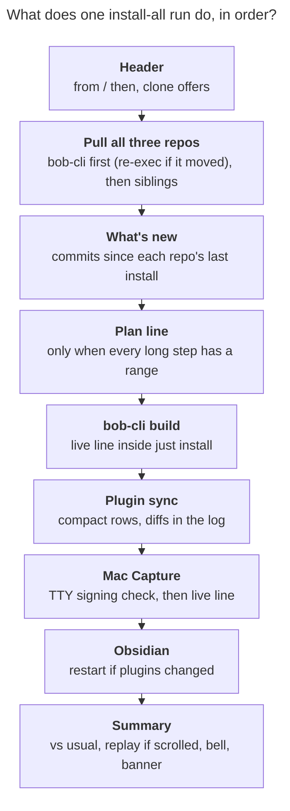

- **PROMPT:**
  [prompts/202611/install_all_wait_and_whats_new.md](https://github.com/bobs-org/bob-cli--agents/blob/main/prompts/202611/install_all_wait_and_whats_new.md)

# Plan: `just install-all`, a wait worth sitting through

## Why

Bryan runs `just install-all` on the Mac about ten times a day. On that 8 GB M1, a real
bob-cli rebuild takes 7–12 minutes. The pane shows four Cargo lines and a
`Building [=====> ] 253/258: bob-obsidian` bar that does not move, and the rest of the
screen is empty (see `~/tmp/screenshots/20261106_123927.png`). The run already knows
which commits it pulled, but it shows only `1 new commit · e0960045 → ec39e1a0` and then
lets compiler output scroll that away.

The research report
`research:202611/install_all_wait_and_whats_new/install_all_wait_and_whats_new.md`
measured the problem on the Mac and merged five independent designs. Bryan accepted all
of its requirement adjustments (R1–R8). This plan follows that report and turns it into
phases with concrete contracts. Where it adds to or departs from the report, the change
is called out under
[Additions to the research design](#additions-to-the-research-design).

## Design principles

- **Intuitive.** Things appear in the order Bryan needs them: what is being installed,
  what changed, how long it usually takes, what is happening now, and how it went. Every
  time phrase is true. An estimate is shown only when history supports it.
- **Reliable.** Only one process writes to the terminal at a time. Every new piece
  degrades to today's exact behavior: missing Python, a helper crash, a corrupt state
  directory, a non-TTY, `-v`, or `BOB_INSTALL_UI=0`. A display failure never changes an
  install outcome or re-runs an install. Exit codes 72, 77, and 78, the restart marker,
  the self re-exec, and clone offers keep their current meaning.
- **Beautiful.** One banner style and one rule. Columns are aligned. Color carries
  meaning: green for added, yellow for fixed, bold red for breaking, dim for provenance.
  Repo names in the digest use their step banner's color. Text never exceeds a 100-cell
  measure on wide panes, the live line never wraps, and nothing is repainted once it has
  scrolled into history.

## The run, end to end



_All pulls finish before the first build. The changes in all three repos are on screen
during the long wait, and the three source snapshots are seconds apart instead of about
10 minutes._

### Screen A: a typical run, during the bob-cli build

```text
🚀  INSTALL ALL
────────────────────────────────────────────────
  from     ~/projects/github/bobs-org
  then     restart Obsidian if the plugin sync changes the vault
  ⇣  bob-cli           ✓  3 new commits · b6a96243 → 8935148f
  ⇣  bob-plugins       ✓  up to date · 5fbe82a
  ⇣  bob-mac-capture   ✓  1 new commit · a2aab30 → 11dcba7

📰  WHAT'S NEW
────────────────────────────────────────────────
  bob-cli · 3 commits since your last install 51m ago
  ⚠ feat!  capture  glue start and past timing to Pomodoro names         79709fed
                    breaking · the commit has no migration note
    feat   gmail    add durable send-recovery engine for compose drafts  8935148f
                    Implements versioned gmail_send frontmatter, file locks,
                    digests and journal helpers (state.rs); persist-sending,
                    pre-dispatch recheck, draft-id-only dispatch, three-outcome
                    recovery with injectable transport plus 16 fault tests.
                    Internal only, no public send command.
                    Verified: cargo fmt --check clean, workspace clippy gate…
    fix    capture  repair successor verdict landing behavior            86b2501b

  bob-mac-capture · 1 commit since your last install 51m ago
    feat   mac-capture  render Bob start tokens without composing hash…  11dcba7

  ⏱  usually 9–12 min on this Mac · done by about 14:16

🦀  BOB-CLI  1/3
────────────────────────────────────────────────
  $ just --justfile ~/projects/github/bobs-org/bob-cli/justfile install
  ⠼ compiling bob-obsidian  ━━━━━━━━━━━━━━━╸────────  4:52 · about 2–4 min left
```

The `Verified:` row reflects DECISIONS `verified_paragraphs = fold`.

### Screen B: the live line in its states

```text
  ⠼ updating crates.io index · 0:03
  ⠼ compiling dependencies 87/235 · 1:12 · Cargo.lock changed, expect a longer build
  ⠼ compiling bob-obsidian · 4:52 · first timed build on this Mac
  ⠼ compiling bob-obsidian · 4:52 · last similar build 7m 50s
  ⠼ compiling bob-obsidian  ━━━━━━━━━━━━━━━╸────────  4:52 · about 2–4 min left
  ⠼ compiling bob-obsidian  ━━━━━━━━━━━━━━━━━━━━━━━╸  11:40 · taking longer than usual (8–10 min)
  ⠼ waiting for another build to release the target directory · 0:14
  ⠼ building Bob Mac Capture app  ━━━━━━━━━━╸──────  0:48 · about 1 min left
  ⠼ signing and installing Bob Mac Capture · 0:06 · a keychain dialog may appear
```

When the build ends, the live line is replaced by one permanent row, and then the
orchestrator's step row follows it:

```text
  ✓ built · 8m 12s · about usual
  ✓ 3 new commits · b6a96243 → 8935148f · installed @ 8935148f
```

### Screen C: finished

```text
🧩  BOB-PLUGINS  2/3
────────────────────────────────────────────────
  $ bob plugins sync --no-pull --repo ~/projects/github/bobs-org/bob-plugins
  ↻ bob-mail                main.js, styles.css
  ↻ bob-navigation-hotkeys  main.js
  ✓ up to date · 5fbe82a · 3 files copied · 9/9 plugins in sync

…

✨  SUMMARY
────────────────────────────────────────────────
  ✓  bob-cli           3 new commits · installed @ 8935148f           8m 12s
  ✓  bob-plugins       up to date · 3 files copied · 9/9 in sync         3s
  ✓  bob-mac-capture   1 new commit · installed ~/Applications/…      1m 41s
  –  obsidian          plugins unchanged · restart not needed

  ✓  ALL INSTALLED · 10m 05s · about usual (9–12 min)
```

Then the terminal bell rings. On macOS a Notification Center banner reads
`ALL INSTALLED · 10m 05s`, with subtitle `bob install-all`.

### Screen D: a failed build

```text
  ✗ build failed after 3:12 · exit 101
      error[E0308]: mismatched types
        --> src/native/gmail/send.rs:212:17
      …
      error: could not compile `bob-obsidian` (lib) due to 1 previous error
      full log  ~/.local/state/bob-cli/install-all/logs/20261106-140412-48213-bob-cli.log
      rerun with  just install-all -v  to stream build output
```

The excerpt starts at the first `error` line and is capped at 40 lines. Without an
`error` line, it shows the last 20 lines. `error` and `warning` words are painted red
and yellow; everything else is dim.

### Screen E: the first run of the morning (grouped level)

```text
  bob-cli · 37 commits since your last install yesterday 23:31
  ⚠ feat!  capture  rewrite relation directions                          0869f792
  ⚠ feat!  capture  glue start and past timing to Pomodoro names         79709fed
    feat   gmail    add durable send-recovery engine for compose drafts  8935148f
    feat   gmail    add safe draft create and update flow                b6a96243
    fix    capture  repair successor verdict landing behavior            86b2501b
    + 32 more · feat 21 (gmail 12 · capture 5 · 4 other) · fix 6 · docs 5
      git -C ~/projects/github/bobs-org/bob-cli log --oneline 1a2b3c4d..0869f792
```

### Screen F: not a TTY (piped, CI, an agent)

There are no `\r` frames, no cursor control, and no color under `NO_COLOR` or a non-TTY.
The digest prints plain subject lines, capped at 60 commits in total, with one `+N more`
line. Builds stream raw output exactly as today and record no build history, though
watermarks still advance.

## Contracts shared across phases

### Code layout

```text
scripts/install_all                bash 3.2-safe orchestrator (kept; never rewritten wholesale)
scripts/lib/install_ui.sh          bash 3.2-safe loader: Python discovery, eligibility, run shim
scripts/lib/install_ui/            stdlib-only Python 3.9 package, run as a directory
  __main__.py                      argparse dispatcher; prepends scripts/lib to sys.path
  term.py                          color, banner, cell width, wrap, sanitize, time formats
  state.py                         state dir, locks, atomic writes, watermarks, history, logs
  commits.py, digest.py            the What's new digest            (digest-engine)
  parsers.py, live.py, history.py  the live runner and recording    (live-runner)
  estimate.py                      ETA ladder                       (live-runner, earned-eta)
  tests/                           unittest suite run by just check-scripts
justfile                           install wraps cargo; install-all passes *args
```

The helper is invoked as `"$py" -B "$repo/scripts/lib/install_ui" <subcommand> …`.
`__main__.py` puts `scripts/lib` at the front of `sys.path` and imports siblings as
`install_ui.<module>`, so tests and runtime use the same import path. `-B` keeps
`__pycache__` out of the tree.

Python rules: standard library only, and Python 3.9 syntax and semantics. Every module
starts with `from __future__ import annotations`. No `match`, no runtime `X | Y` unions,
and no 3.10+ stdlib APIs. A test enforces the syntax part with
`ast.parse(src, feature_version=(3, 9))`.

Bash rules: everything stays 3.2-safe. No associative arrays, `mapfile`/`readarray`,
`${x,,}`/`${x^^}`, `|&`, `;;&`, `coproc`, `[[ -v`, namerefs, negative array indexes,
`${x@Q}`, `wait -n`, or `EPOCHSECONDS`/`EPOCHREALTIME`. Guard every possibly-empty array
expansion as `${arr[@]+"${arr[@]}"}`, because bash 3.2 treats an empty `"${arr[@]}"` as
unbound under `set -u`. A lint test greps for the forbidden constructs.

### Helper error policy

- Usage errors exit 2. An expected failure (bad repo, unreadable state) prints one dim
  line to stderr and exits 1.
- An unexpected exception prints
  `install_ui: internal error (details in <state>/crash.log)`, appends the traceback to
  `crash.log`, and exits 70.
- Every bash call site treats a nonzero helper status as "feature unavailable": it shows
  at most one dim notice and continues. A helper failure never fails an install step.

### Escape hatches (environment)

| Variable                      | Effect                                                                         |
| ----------------------------- | ------------------------------------------------------------------------------ |
| `BOB_INSTALL_UI=0`            | Never call the helper; today's behavior except the pull-first order.           |
| `BOB_INSTALL_UI_PYTHON=/path` | Use this interpreter if it is ≥ 3.9 (otherwise treat as unavailable).          |
| `BOB_INSTALL_VERBOSE=1`       | Raw build and sync output (same as `install-all -v`); the digest still prints. |
| `BOB_INSTALL_NOTIFY=0`        | No bell and no macOS completion banner.                                        |
| `BOB_INSTALL_STATE_DIR=/path` | Override the state directory (tests).                                          |

### State directory

The state directory is
`${BOB_INSTALL_STATE_DIR:-${XDG_STATE_HOME:-~/.local/state}/bob-cli/install-all}`, the
same directory as today's `obsidian-restart-pending` marker. It is per host and never
vault-synced. Directories are created `0700` and files `0600`. Every read tolerates
missing or corrupt data. Every write is best effort.

- `installed.json`: install watermarks, rewritten atomically (temp file in the same
  directory, `fsync`, `rename`) under `fcntl.flock` on `installed.json.lock`:

  ```json
  {
    "v": 1,
    "repos": {
      "bob-cli": {
        "sha": "<full sha>",
        "at": "2026-11-06T13:24:51-05:00",
        "dirty": false,
        "path": "/Users/bbugyi/projects/github/bobs-org/bob-cli"
      }
    }
  }
  ```

  A watermark advances only after a successful install of that repo on this host.
  bob-cli advances when `just install` succeeds. That includes plain `just install`, and
  `just install` is the only writer for bob-cli. bob-plugins advances after a sync that
  leaves no drift. bob-mac-capture advances after an install that exits 0 or 72.

- `runs.jsonl`: build history. Each row is one `os.write` on an `O_APPEND` descriptor
  and stays under 4 KiB, so concurrent appends never interleave. Malformed lines are
  skipped. When the file passes 2,000 lines it is trimmed to the newest 1,500, under the
  lock, using temp file and rename. Row schema (`v: 1`), one row per declared phase per
  step run, including phases that took 0 s:

  ```json
  {
    "v": 1,
    "run": "20261106-140412-48213",
    "ts": "2026-11-06T14:12:31-05:00",
    "host": "Kellys-MacBook-Pro",
    "step": "bob-cli",
    "phase": "crate",
    "kind": "rebuild",
    "secs": 412.3,
    "waited": 0.0,
    "outcome": "ok",
    "toolchain": "rustc 1.95.0 (…)",
    "profile": "local-install",
    "incremental": true,
    "slept": false
  }
  ```

  `outcome` is `ok`, `fail`, or `interrupted`. `waited` is time spent blocked on Cargo's
  file lock; it is already subtracted from `secs`. `slept` is true when wall time and
  monotonic time differ by more than 30 s, because monotonic time does not advance while
  a laptop sleeps.

- `logs/<run>-<step>.log`: full raw child output. Keep the newest 10 per step.
- `runs/<run>/`: per-run scratch files (`digest.json`, runner `--rows-file` counts).
  Keep the newest 10 run directories.
- `crash.log`: helper tracebacks, trimmed to the last 200 KiB.

### Run identity and the self re-exec (protocol 2)

`install_all` creates `BOB_INSTALL_RUN_ID=<YYYYmmdd-HHMMSS>-<pid>` once and exports it,
so every helper call, including the ones inside `just install`, shares one run ID. When
the bob-cli pull moves HEAD, the script re-execs itself as it does today. It exports the
existing variables plus:

| Variable                                 | Value                            |
| ---------------------------------------- | -------------------------------- |
| `BOB_INSTALL_ALL_PROTOCOL`               | `2`                              |
| `BOB_INSTALL_ALL_SELF_PULL_OLD` / `_NEW` | full pre-pull and post-pull SHAs |
| `BOB_INSTALL_ALL_RUN_ID`                 | the run ID                       |

The re-exec'd script unsets them after reading, as it does today. **Legacy upgrade:**
the first run after this lands is re-exec'd by today's script. That run has no
`PROTOCOL` variable, only `BOB_INSTALL_ALL_SELF_PULL_DETAIL`
(`N new commit(s) · <old> → <new>`). Parse both short SHAs, resolve them with
`git rev-parse --verify <sha>^{commit}`, and check
`git merge-base --is-ancestor old new`. If any of that fails, print one dim
`changes unavailable for this upgrade` row instead of a bob-cli digest. Never guess from
the reflog. The old script already printed its own `BOB-CLI 1/3` banner and pull row, so
this one upgrade run may show that banner twice. That is acceptable. A crash or a wrong
range is not.

### The digest

`install_ui digest` takes these arguments. Each map option is repeatable as `NAME=VALUE`
and keyed by repo name.

- `--repo NAME=DIR`: also sets display order.
- `--pre NAME=SHA`, `--post NAME=SHA`, `--pull NAME=STATE`, where STATE is one of
  `updated|current|warn|cloned|none`.
- `--color NAME=ANSI`: the step banner color, used for the repo name.
- `--plugins NAME`: which repo is bob-plugins.
- `--bob-bin PATH`: optional.
- `--steps N`: the number of enabled steps, used for the row budget.
- `--record PATH`: optional JSON record.

It prints the whole section, banner included, or nothing when there is nothing new.

- **Range per repo.** Call the watermark W.
  - If W is a commit and an ancestor of HEAD, use `W..HEAD`, labelled
    `since your last install <relative time>`. If W equals HEAD, show nothing for that
    repo.
  - Otherwise, if pre and post differ, use the pull range, labelled `in this pull`. When
    a W existed but was unusable, add a dim note:
    `last install @abc1234 isn't in this history`.
  - A `cloned` repo shows one row, `initial checkout @ <sha>`, and never dumps history.
  - A `warn` (failed pull) repo uses only a valid W range, never an invented pull range.
  - A dirty tree adds `installing with uncommitted changes in N files`.
  - Relative times read `51m ago`, `3h ago`, `yesterday 23:31`, or `Nov 2`.
- **Extraction.** Count with `git rev-list --count RANGE`, which is authoritative. List
  with `git -C DIR log --no-color -z -n 200 --format=%H%x1f%s%x1f%b RANGE`, decoded as
  UTF-8 with `errors="replace"`.
- **Parsing.** Use the release-plz subject grammar,
  `^(?P<type>[a-z]+)(\((?P<scope>[^)]*)\))?(?P<bang>!)?: (?P<subject>.+)$`. Subjects
  that do not match have no type and go to the "other" group. A commit is breaking when
  it has `!` or a `BREAKING CHANGE:`/`BREAKING-CHANGE:` footer (the footer text runs to
  the next blank line).
- **Trailer stripping.** Remove only the final run of paragraphs made entirely of
  `SASE_[A-Z0-9_]+=…` lines, the `[n]: https://…` link definitions those lines use, and
  `Co-Authored-By:`/`Signed-off-by:` lines. A mixed or malformed final block stays
  untouched, and `BREAKING CHANGE:` text is never stripped.
- **Verified paragraphs** (a paragraph starting `Verified:`) follow DECISIONS
  `verified_paragraphs`. Under `fold`, they are one dim row cut with `…`. They are never
  used as a lead paragraph.

> [!decision] verified_paragraphs = dim The whole paragraph renders dim and counts fully
> against the row budget.

> [!decision] verified_paragraphs = show The paragraph renders like any other body text.

- **Order.** Breaking → `feat` → `fix` → `perf` → `revert` → other, mirroring
  `release-plz.toml`, newest first within each group. Repos appear in run order.
- **Levels.** Pick the richest level that fits and apply it to every repo:
  1. full bodies;
  2. lead paragraph, at most 4 rows, cut with `…`;
  3. subjects only;
  4. grouped: breaking commits, then top subjects by group until the budget runs out,
     then `+ N more · feat 21 (gmail 12 · capture 5 · 4 other) · fix 6 · docs 5` and a
     copyable `git -C <dir> log --oneline <base>..<head>`. At this level `docs`, `test`,
     `refactor`, `chore`, `ci`, `style`, and `build` fold into the count line.

  Breaking commits always show their badge plus the footer, else the lead paragraph,
  else `breaking · the commit has no migration note`. They never fold into `+N more` and
  may exceed the budget.

- **Budget.** `budget = clamp(LINES − reserve, 8, floor(0.6 × LINES))`, where
  `reserve = 8 + 2 + 4×steps + (6 + steps) + 2`. That is about 41 rows on Bryan's 79-row
  pane. Count rows in terminal cells after wrapping.
- **Layout.** The measure is `W = min(COLUMNS − 1, 100)`.
  - Row: `{badge:2}{type:<T}  {scope:<S}  {subject}…{sha}`. T is the widest type in the
    digest. S is the widest scope in the repo, capped at 16 and cut with `…`. The 8-char
    SHA is dim and right-aligned at W.
  - Narrow panes: below 60 columns, drop the SHA. Below 45, fold scope into the subject
    as `scope: subject`.
  - Bodies are indented to the subject column and wrapped at `min(80, W − indent)`
    cells. Commits with bodies get one blank row between them; subject-only commits get
    none.
  - Colors: `feat` green (32), `fix` yellow (33), `perf` cyan (36), `revert` magenta
    (35), other types dim. A breaking badge `⚠` and its type are bold red (1;31). Scope
    and SHA are dim.
  - The repo header line is `{name} · N commit(s) {range label}`, with the name bold in
    its step color and the rest dim. The bob-plugins header adds `· will update a, b`
    when `--bob-bin` is given: the helper runs
    `bob plugins sync --dry-run --format json --no-pull --repo DIR` with a 10 s timeout
    and lists plugin IDs that have a file action of `created`, `updated`, or `forced`.
    On any failure it omits the clause.
- **Safety.** Every commit-derived string goes through `term.sanitize`. C0/C1 control
  characters and DEL become caret notation (`^[`), and tabs become spaces, so a message
  can never move the cursor or forge rows.
- **Record** (`--record`):
  `{"v":1, "rows": <rows printed>, "level": "full|lead|subjects|grouped", "repos": [{"name", "count", "label", "base", "head", "breaking": n, "subjects": [first 3 rendered subjects]}]}`.
  The summary replay (earned-eta) reads it.

### The live runner

The runner command is
`install_ui run --step NAME --parser cargo|swiftpm --repo DIR [--crate bob-obsidian] [--profile P] [--done TEXT] [--started-file PATH] [--rows-file PATH] -- CMD…`.

- **Spawn.** Use `stdin=/dev/null`, so an unexpected prompt fails fast instead of hiding
  behind a spinner. Merge stdout and stderr into one pipe to keep their order. For
  `--parser cargo`, also set `CARGO_TERM_PROGRESS_WHEN=always` and
  `CARGO_TERM_PROGRESS_WIDTH=80`, which makes Cargo emit `\r` progress frames into the
  pipe. Touch `--started-file` right after the spawn succeeds.
- **Loop.** A `selectors` loop with a 100 ms tick drains output continuously with
  `os.read`, so a chatty child never blocks. Split on `\n` and `\r`, and write every raw
  line to the log.
  - Known chatter (below) goes only to the log.
  - **Every other line is printed above the live line as it arrives**: `\r\033[K`, the
    line, newline, then redraw. That keeps rustc warnings and Mac Capture's
    Accessibility, ad-hoc signing, and "choose Always Allow" notices visible.
- **Rendering.**
  - Hide the cursor while live. Redraw at most 10 times a second with `\r…\033[K`,
    truncated to `min(cols − 1, 100)` cells. Read the terminal size on every frame,
    which covers resizes with no SIGWINCH handler.
  - Elapsed time ticks at 1 Hz. ETA text changes at most every 10 s. The spinner
    (`⠋⠙⠹⠸⠼⠴⠦⠧⠇⠏`, cyan) keeps turning while the child is silent.
  - If any display error occurs after the spawn, switch to raw passthrough for the rest
    of the run. Always wait for the child and return its exact status.
- **Phases.** Cargo, with the crate named by `--crate`:
  - `index`: `Updating`, `Locking`, `Downloading`, `Downloaded`.
  - `deps`: `Compiling <other crate>`. When frames carry it, show the `n/m` counter.
  - `crate`: `Compiling bob-obsidian` until `Finished`.
  - `finish`: `Finished`, `Installing`, `Replacing`, `Installed`.

  SwiftPM:
  - `app`: the first `Building for production…` through `Build complete!`.
  - `helper`: the second `Building for production…` through `Build complete!`.
  - `install`: everything after the second `Build complete!`.

- **Known chatter.** Cargo: the status verbs above, `Building [` frames, `Fresh`,
  `Adding`, `Blocking`. SwiftPM: `[n/m] …`, `Building for production…`,
  `Build complete!`, `Compiling`, `Linking`, `Write`, `Emitting module`,
  `Planning build`, `Fetching`, `Cloning`, `Resolving`, `Computing`, `Applying`. Mac
  Capture: the final stdout line that is an absolute path ending in `.app`. Keep the
  patterns in one table in `parsers.py` with fixture tests.
- **Lock wait.** `Blocking waiting for file lock …` shows
  `waiting for another build to release the target directory`, and that time goes into
  `waited`, not into training.
- **Change kind**, predicted before the build from local state:
  - `noop`: HEAD equals the watermark, the tree is clean, and the installed artifact
    exists (`$root/bin/bob` or `~/Applications/Bob Mac Capture.app`).
  - `cold`: there is no build directory (`${CARGO_TARGET_DIR:-target}/<profile dir>` or
    Mac Capture's `.build/release`), or the toolchain string differs from the newest
    recorded row for the step.
  - `deps`: the range from the watermark (or the pull range) touches `Cargo.lock`, any
    `Cargo.toml`, or `rust-toolchain.toml`. For Mac Capture it touches `Package.swift`
    or `Package.resolved`. A dirty dependency file counts too.
  - `rebuild`: anything else.

  Kind nouns used in text: build, dependency rebuild, cold build, no-change install.
  `deps` adds the hint `Cargo.lock changed, expect a longer build`.

- **Toolchain.** Probe once per run with a 5 s timeout: the first line of `rustc -V`,
  run in the repo, or of `Scripts/xcode-swift.sh --version`. On failure use `unknown`.
  `incremental` is `CARGO_INCREMENTAL != "0"` for Cargo and `null` for SwiftPM.
- **Ends.**
  - Success replaces the live line with `✓ {done} · 8m 12s` (the comparison suffix comes
    in earned-eta).
  - Failure prints Screen D.
  - Write one history row per declared phase, then `--rows-file` (the number of rows the
    runner left in scrollback). Exit with the child's status.
- **Signals.**
  - While the child runs, the runner ignores SIGINT; the child gets it from the
    foreground process group. When the child exits, the runner clears the line, restores
    the cursor, prints `✗ interrupted after 4:12`, records `interrupted`, resets SIGINT
    to the default handler, and kills itself with SIGINT. The parent `just` and bash
    processes then see a signal death and stop (wait-and-cooperative-exit).
  - SIGTERM and SIGHUP are forwarded to the child and get the same cleanup and re-raise.
  - The cursor is restored on every exit path (`finally`, `atexit`, and the signal
    paths).
- **ETA ladder (live-runner part).** Use samples that match host, step, kind, toolchain,
  profile, and incremental, with `ok` outcome and not slept. With 0 samples, show
  `first timed {kind noun} on {this Mac|<short hostname>}`. With 1 or more, show
  `last similar build 7m 50s` (that run's step total). earned-eta adds the range rung on
  top of this API.

### The bash run shim

`install_ui_run` is defined in `scripts/lib/install_ui.sh`. It uses the runner only when
stdout is a TTY, `TERM` is not `dumb`, neither `BOB_INSTALL_VERBOSE` nor
`BOB_INSTALL_UI=0` is set, and Python ≥ 3.9 resolves. Otherwise it execs the command
directly. When the runner exits nonzero and the started file was never created, the
helper failed before the child existed, so the shim runs the command directly. Every
other status is the child's status, returned unchanged. That rule is why a display
failure can never re-run a successful install.

## Additions to the research design

| #   | Addition                                                                                                        | Why                                                                                                                                                                    |
| --- | --------------------------------------------------------------------------------------------------------------- | ---------------------------------------------------------------------------------------------------------------------------------------------------------------------- |
| A1  | Plugin-sync output is quieted during install-all (DECISIONS `plugin_diffs`).                                    | `bob plugins sync` prints unified diffs, up to 60 lines per file. One plugin update would scroll the digest away. The research did not cover this.                     |
| A2  | The step ends with two rows: the runner's `✓ built · 8m 12s · about usual`, then the orchestrator's result row. | The runner works without install-all (plain `just install`), and the orchestrator alone knows the SHA and the step's warnings. Two honest rows beat a fragile handoff. |
| A3  | History is trimmed at 2,000 rows, not 500.                                                                      | About 8 rows per run means 500 rows is 6 days, which would starve rare kinds (`deps`, `cold`) of samples.                                                              |
| A4  | Non-TTY builds stream raw output and record no history.                                                         | Agents and CI want the raw stream. Agent shells also export `CARGO_INCREMENTAL=0`, which the key would exclude from training anyway.                                   |
| A5  | The `quick` rule is a read-time filter. Among `rebuild` samples, drop any below a third of their median.        | It gives the same estimate as relabelling at record time, keeps raw history honest, and needs no rewrite when the rule is tuned.                                       |
| A6  | `just install` writes the bob-cli watermark starting in the first phase.                                        | Watermarks start accumulating before the digest ships. The bob-cli watermark has one writer whether the install came from install-all or not.                          |
| A7  | A completion banner skips the `$ osascript …` command echo.                                                     | It is a pure notification, so the echo would only add noise below the summary. Restart banners keep their echo.                                                        |

## Phase details

Each phase lands green on `just check-scripts` (which CI's lint job runs) and leaves
install-all fully working. Commit subjects use `feat(install):`, `test(install):`, or
`docs(install):`. No phase edits the `Cargo.toml` version or `CHANGELOG.md`; the release
train owns both (decisions:bob-cli-releases-ride-a-daily-train). Nothing here is a CLI
or JSON contract break, so no `!`.

### Phase `ui-core`

1. Create the package: `__init__.py`, `__main__.py` (dispatcher, the error policy, and
   `sys.path` setup), `term.py`, and `state.py`.
2. `term.py` provides:
   - `use_color(stream)`: TTY, `NO_COLOR` unset, and `TERM != dumb`.
   - `paint`, plus `banner()`, which must be byte-identical to `install_all`'s `banner`
     in both color modes. Test it against literal fixtures.
   - `cell_width`, `truncate_cells` (with `…`), `wrap_cells`, `strip_ansi`, and
     `sanitize`. Wide and fullwidth characters count 2 cells, combining marks 0.
   - `format_duration`, identical to bash (`45s`, `8m 12s`); `format_clock` (`4:52`,
     `1:02:03`); `format_relative`.
   - `terminal_size()`: the stream, then `COLUMNS`/`LINES`, then 80×24.
   - `host_label()`: `this Mac` on Darwin, otherwise the short hostname.
3. `state.py` provides the state dir resolution, private modes, the lock, atomic JSON,
   watermark read and write, history append, read, and trim, log path allocation and
   pruning, and crash-log append. Every function catches `OSError` and reports that
   state is unavailable instead of raising into callers.
4. Subcommands:
   - `mark-installed --repo NAME --dir DIR` records the full HEAD SHA, the dirty flag,
     and the path. It always exits 0 and prints a dim warning on failure.
   - `watermark --repo NAME [--json]` is for diagnostics and tests.
5. `scripts/lib/install_ui.sh` (sourced by the `install` recipe now, and by
   `install_all` from pull-first-run on):
   - `install_ui_python` resolves Python ≥ 3.9 once and caches it in
     `BOB_INSTALL_UI_PYTHON`. It honors the override and `BOB_INSTALL_UI=0`.
   - `install_ui` runs the helper.
   - `install_ui_mark_installed` is best effort and silent on failure.
6. The justfile `install` recipe calls `install_ui_mark_installed bob-cli "$PWD"` after
   a successful `cargo install` and completion install.
7. Tests:
   - `tests/test_term.py` and `tests/test_state.py`: concurrent appends from two
     processes, a corrupt `installed.json`, an unwritable dir, trim, and lock
     contention.
   - `tests/test_portability.py`: 3.9 syntax via `feature_version`, the
     `from __future__ import annotations` rule, and the bash 3.2 lint over
     `scripts/install_all` and `scripts/lib/install_ui.sh`.
8. `just check-scripts`: add the new shell file to `bash -n`, and run
   `python3 -B -m unittest discover` over `scripts/lib/install_ui/tests` with
   `scripts/lib` as the top level.

Acceptance: `just check-scripts` passes. `just install` still behaves exactly as today,
and afterwards `installed.json` holds the bob-cli watermark.

### Phase `digest-engine`

1. `commits.py` covers range resolution, extraction, Conventional Commit parsing, the
   breaking footer, trailer stripping, Verified detection, and lead paragraphs.
   `digest.py` covers levels, budget, layout, plugin names, the non-TTY mode, and
   `--record`.
2. Implement [The digest](#the-digest) exactly. Keep the levels and budget pure
   functions of (commits, cols, lines, steps) so they test without Git.
3. Tests use real temp Git repos with fixed author and committer dates and
   `GIT_CONFIG_NOSYSTEM=1`. Cover:
   - Volume: 0, 1, 3, 16, and 59 commits.
   - Bodies: SASE-only, prose plus SASE, a `BREAKING CHANGE:` footer, `!` with no
     footer, a `Verified:` paragraph under each decision branch, and a non-conventional
     subject.
   - Hostile content: control bytes and ESC sequences in messages, and wide characters.
   - Terminal sizes: `LINES` 24, 40, and 79 crossed with `COLUMNS` 40, 80, and 260.
   - Range edge cases: a first clone, a failed pull with and without a valid watermark,
     a watermark object missing, a non-ancestor watermark, W equal to HEAD, a dirty
     tree, and a merge commit.
   - The plugin dry-run: success, timeout, and bad JSON (use a fake `bob`).
   - The non-TTY cap of 60.

   Add golden snapshots, without color, for Screens A (digest part) and E. Add one
   colored snapshot.

Acceptance: running the digest against this repo prints a section that matches the
layout rules at 80 and 260 columns. The suite passes on the CI Python and the
portability gate.

### Phase `live-runner`

1. `parsers.py` holds the chatter tables and phase detectors. `live.py` holds the loop,
   renderer, signals, excerpt, and final rows. `history.py` holds the kind prediction,
   toolchain probe, rows, and slept detection. `estimate.py` exposes
   `estimate(step, kind, key, elapsed, phase) -> Estimate(text, low, high, fill)` and
   implements the learning and last-similar rungs.
2. Subcommands:
   - `run`, per [The live runner](#the-live-runner).
   - `record --step --phase --secs --outcome [--kind]` appends a bash-timed row, used
     for plugin sync and the Obsidian restart.
   - `kind --step --repo [--profile]` prints the predicted kind.
3. Tests:
   - Fake children: small Python scripts that replay captured Cargo and SwiftPM fixtures
     with delays, `\r` frames, partial lines, a 100k-line flood, 3 s of silence, a lock
     wait, exit 101, and exit 72.
   - An injectable clock for the renderer.
   - PTY tests (`pty.openpty`, `os.setsid`, and a real process group) that assert:
     - no frame exceeds the width, and the cursor is restored;
     - passthrough lines land above the live line;
     - Ctrl-C (SIGINT to the group) gives a child death, an `interrupted after` message,
       a runner signal death, and an `interrupted` row;
     - SIGTERM is forwarded;
     - started-file semantics hold;
     - an injected renderer fault still returns the child's exact status;
     - history rows match the schema, including 0 s phases and `waited`.

Acceptance: wrap a slow fake build by hand in a real terminal. It shows the spinner,
phases, and elapsed time, and Ctrl-C leaves a clean prompt.

### Phase `pull-first-run`

1. `scripts/install_all` sources `scripts/lib/install_ui.sh` and creates or receives the
   run ID.
2. Factor `plugins_eligible` and `mac_capture_eligible` out of the step functions. These
   are today's pre-pull checks: directory, `plugins/` subdir, vault, Darwin, and
   `Scripts/install.sh`. Pulls and steps both use them.
3. Change `pull_repo` to capture full pre and post SHAs. Store per-repo results in
   distinct variables (bash 3.2 has no associative arrays).
4. New order: header → clone offers (unchanged) → bob-cli pull (re-exec on update, with
   protocol 2) → eligible sibling pulls → digest → steps.
   - Pull rows print under the header as `  ⇣  {name:<16} {glyph}  {detail}`, with
     today's dim diagnostics on a failed pull. They drop the `$ git … pull` echo.
   - Steps consume the recorded pull results and no longer pull. Summary details keep
     today's content.
5. Call `install_ui digest` with `--record "$state_dir/runs/$run_id/digest.json"`.
   Create that per-run directory, and keep only the newest 10. Pass `--bob-bin` when a
   `bob` binary exists. If the call fails, print one dim `what's new unavailable` row.
6. Watermarks: bob-plugins after a drift-free sync; bob-mac-capture after install exit 0
   or 72.
7. Export `BOB_INSTALL_ALL=1` to `just install`. Under it, the justfile skips the nested
   `📦 INSTALL` banner and runs `bob completion install -q`.
8. Completion cues, on normal completion only, never after an interrupt, and never under
   `BOB_INSTALL_NOTIFY=0`:
   - Ring the bell (`\a`) when stdout is a TTY and the run took ≥ 60 s.
   - On Darwin, post a quiet banner (A7) when the run took ≥ 120 s. Its title is the
     final status line text, for example `ALL INSTALLED · 10m 05s`,
     `INSTALLED WITH 1 WARNING · …`, or `1 STEP FAILED · …`.
9. Tests: `tests/test_install_all.py` builds a sandbox.
   - Repos: bare remotes plus clones for bob-cli (holding a copy of `scripts/` and a
     fake justfile whose `install` emits Cargo-like lines), bob-plugins, and
     bob-mac-capture (a fake `Scripts/install.sh` and justfile).
   - Fake bins on `PATH`: `bob` (fixture JSON), `uname`, `osascript`, `pgrep`, `open`.
     Use isolated `HOME` and `XDG_STATE_HOME`.
   - Scenarios:
     - nothing new;
     - a self update re-exec under protocol 2;
     - a legacy re-exec env, both with a parseable detail and with a garbage one;
     - sibling updates;
     - a failed sibling pull;
     - a retry after a failed install, which shows the same commits again;
     - a watermark advance after success;
     - `BOB_INSTALL_UI=0`;
     - the Darwin path through fake `uname`, including exit 72;
     - the bell on a PTY, and its absence under non-TTY and `BOB_INSTALL_NOTIFY=0`.

Acceptance: in the sandbox, Screen A's header and digest appear in that order. Every
existing exit-code path still reports the same summary row.

### Phase `quiet-builds`

1. Add `install_ui_live_eligible` and `install_ui_run` to `scripts/lib/install_ui.sh`
   (see [The bash run shim](#the-bash-run-shim)).
2. The justfile `install` recipe runs `env RUSTC_WRAPPER= cargo install …` through
   `install_ui_run` with
   `--step bob-cli --parser cargo --crate bob-obsidian --profile "$profile" --done built`.
   `BOB_INSTALL_VERBOSE=1` bypasses it.
3. `scripts/install_all` gets an `-h, --help` / `-v, --verbose` usage block (sorted,
   both with short aliases, per `cli_rules.md`). `-v` exports `BOB_INSTALL_VERBOSE=1`.
   The justfile gets `install-all *args` with `[positional-arguments]` and passes them
   through. Update the recipe comment to mention `-v`.
4. The Mac Capture step, when stdin and stdout are TTYs and the checkout's justfile has
   a `signing-check` recipe:
   - Run `just signing-check` first with stdin and stderr on the terminal (its keychain
     unlock offer needs them). Capture stdout and print it as a dim
     `signing  <identity>` row.
   - Exit 77 or 78 gets today's remedy rows and skips the install.
   - Then run the install through
     `install_ui_run --step bob-mac-capture --parser swiftpm --done "built and signed"`.
   - Exit codes 72, 77, and 78 keep today's meaning, and the ad-hoc check is unchanged.
5. The plugin sync follows DECISIONS `plugin_diffs`. Under `log`, when the UI is live:
   - Write the real sync's stdout and stderr to `logs/<run>-bob-plugins.log`.
   - Render one `↻ <id>  <files>` row per plugin with copied files, from the
     post-install dry-run preview the step already takes. Echo every captured line that
     `render.rs` marks as a warning, block, or failure (its `⚠`/`✗` glyph rows and their
     indented detail rows), but never diff lines.
   - On a nonzero exit, print the log excerpt and path.

   `-v`, a non-TTY, or `stream` keeps today's raw stream.

   > [!decision] plugin_diffs = stream Skip item 5. The plugin sync keeps streaming, and
   > its rows still count toward the summary replay (earned-eta).

6. Interrupts: install a bash `INT` trap. It clears any partial line, prints
   `✗ interrupted after m:ss`, skips the remaining steps, the summary, and the cues, and
   exits 130. A step exit status of 130 takes the same path, as a backstop.
7. Record bash-timed rows for the plugin sync and the Obsidian restart with
   `install_ui record`.
8. Tests: extend the end-to-end harness with PTY scenarios.
   - The live line appears and is replaced by the `built` row.
   - `-v` and non-TTY stream raw output.
   - A failing fake Cargo shows Screen D, a fail summary row, and exit 1.
   - Ctrl-C mid-build exits 130 with no later steps and no bell.
   - On the Mac path, the signing check runs before the install, the 77 remedy shows,
     and the 72 warning is preserved.
   - Plugin diff lines land in the log, not on the terminal, and warning rows still
     show.
   - The started-file fallback re-runs nothing after the child has started.

Acceptance: a sandbox run on a PTY shows Screens A–D. `just install` from a terminal
shows the live line, and from a pipe streams Cargo exactly as before.

### Phase `earned-eta`

1. `estimate.py` adds:
   - **Samples:** the last 10 matching rows within 60 days. For `rebuild`, apply the A5
     filter.
   - **Range rung:** at least 5 samples with `p80/p20 ≤ 1.6` for every phase that has
     `p80 ≥ 10 s` (short phases need only 1 sample). The remaining time is the current
     phase's `[max(0, p20 − e), max(0, p80 − e)]` plus the later phases' `[p20, p80]`.
   - **Wording:** above 2 minutes, round to whole minutes (`about 2–4 min left`); then
     `about 1 min left`; then `under a minute`. Never show 0 or negative values.
   - **Bar:** 24 cells, `━` in the step color, a `╸` tip, and `─` dim. Fill is elapsed
     over the sum of p80, capped at 97% and never moving backwards. The bar is hidden
     below 70 columns.
   - **Overtime:** once the step's elapsed time passes the sum of p80, show
     `taking longer than usual (8–10 min)` in yellow, and the fill stops.
   - **Final row suffix:** `faster than usual`, `about usual`, or `slower than usual`,
     only when the range rung applied.
2. Add a `plan --steps …` subcommand. After the digest, `install_all` prints
   `⏱ usually 9–12 min on this Mac · done by about 14:16` (the time is now plus the high
   end), but only when bob-cli and, when enabled, Mac Capture both have a range for
   their predicted kinds. The plugin and Obsidian medians are added when known.
3. The summary's final status line gains `· about usual (9–12 min)` (or `faster` or
   `slower`) when the plan line was shown.
4. **Replay.** `install_all` counts rows printed after the digest:
   - its own output helpers, with long rows counted as `ceil(cells / cols)`;
   - each runner's `--rows-file`;
   - captured sync output.

   Then it calls `install_ui replay --record … --rows-after N`. That prints a compact
   recap under the summary rows,
   `what's new  bob-cli 3 · ⚠ glue start and past timing…, +2 more`, one row per repo,
   but only when `digest rows + rows after + summary rows > LINES`.

5. Tests: estimator tables cover 0, 1, 4, and 5 samples, the dispersion gate, outliers,
   slept and failed rows, a mismatched toolchain, kind, or incremental key, overtime,
   monotonic fill, and rounding at the edges. Also test plan-line gating, summary
   wording, and the replay threshold at `LINES` 24 and 79.

Acceptance: a seeded `runs.jsonl` with 6 consistent samples makes a sandbox run on a PTY
show the bar, the range, the plan line, and the summary comparison. An empty history
shows only the learning text.

### Phase `docs-acceptance`

1. Rewrite `docs/guides/install-everything.md`:
   - a current sample run (header pull rows, What's new, the live line, the summary);
   - what the ETA phrases mean and why the first runs only learn;
   - `-v` and the escape-hatch variables;
   - the log and state locations;
   - the bell and banner.

   Remove the stale `installed`/`synced` sample rows.

2. `docs/start/install.md` gets one short paragraph: on a terminal, `just install` shows
   a live status line, and `BOB_INSTALL_VERBOSE=1` streams raw Cargo output. `-v` is a
   script option, not a `bob` flag, so `just docs-gen` does not apply. Run
   `just docs-check`.
3. Acceptance transcripts:
   - Run a real `just install` from the workspace under `script`, with an isolated
     `CARGO_INSTALL_ROOT`, `XDG_STATE_HOME`, and completion target. Keep the real
     `CARGO_HOME` and `RUSTUP_HOME`.
   - Run a sandboxed `scripts/install_all` with `BOB_DIR` pointed at a temp vault, so no
     real Obsidian restart or plugin sync can happen.

   Attach both transcripts to the phase bead.

4. Record `PROPOSED FOLLOW-UP:` notes on the bead:
   - (a) Bryan's first Mac run verifies the signing-check prompt, the live line during
     SwiftPM, and the banner.
   - (b) A measured Mac build-speed investigation (`cargo build --timings` on the 8 GB
     M1; research R8), now that `runs.jsonl` holds the baseline.
   - (c) After a week of history, tune the 1.6 dispersion gate and the p20/p80 choice.

## Testing strategy

- **Unit:** term, state, commits, digest, parsers, and estimate, as pure functions with
  injected clocks and sizes.
- **Integration with real Git:** temp repos and bare remotes. Nothing touches the
  network or Bryan's checkouts.
- **PTY:** every claim about what the terminal shows (no wrap, cursor restored, the
  interrupt path, the bell) is tested through `pty.openpty`, never by checking `isatty`
  on a pipe.
- **Portability:** the 3.9 syntax gate and the bash 3.2 lint run in CI's lint job via
  `just check-scripts`. The macOS-only branches are tested on Linux through a fake
  `uname`.
- **No behavior change** without the helper: the end-to-end suite runs key scenarios
  with `BOB_INSTALL_UI=0` and compares the summary rows with today's.

## Out of scope

- Making builds faster (R8). The follow-up is recorded in docs-acceptance.
- A `bob install-all` subcommand, a full-screen TUI, scroll regions, a PTY passthrough
  around children, OSC 9;4 progress, or window and tmux title tickers. The research
  rejected these for bootstrap circularity, two writers, or invisibility in Bryan's
  tmux.
- Changes to bob-mac-capture or bob-plugins. The runner parses their current output.
  Explicit phase markers in Mac Capture's `Scripts/install.sh` can follow later as a
  versioned opt-in contract.
- A pager, author/diffstat cards, or `CHANGELOG.md` deltas in the digest.

## Risks and mitigations

| Risk                                                  | Mitigation                                                                                                                                                   |
| ----------------------------------------------------- | ------------------------------------------------------------------------------------------------------------------------------------------------------------ |
| A hidden prompt hangs behind the spinner.             | Children get `stdin=/dev/null`. The only prompt (the keychain unlock) runs first in a TTY preflight. Git pulls and clone offers never run under a live line. |
| A new Mac Capture notice gets swallowed.              | Only known chatter is hidden. Every unknown line passes through, and every line is in the log.                                                               |
| The first upgrade run mis-handles the legacy re-exec. | The parse is explicit, the end-to-end harness covers parseable and garbage details, and the fallback is a single `changes unavailable` row.                  |
| Bash 3.2 regressions on the Mac.                      | A lint test, the empty-array guard rule, and all new logic in Python.                                                                                        |
| An estimate lies.                                     | It is gated on comparable, consistent history, anchored to the slow end, never counts to zero, and switches to words once overtime.                          |
| Concurrent runs corrupt state.                        | `O_APPEND` single-write rows, a flock around rewrites, per-run log names, and Cargo's own build lock, shown as waiting.                                      |
